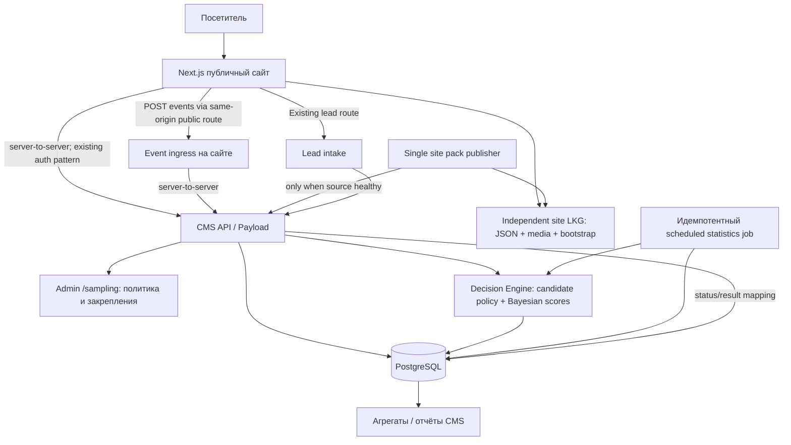
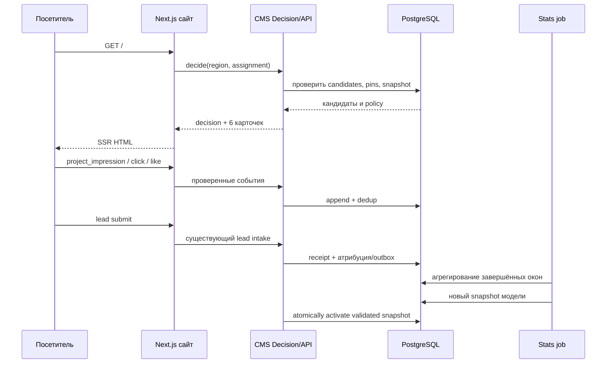

# RFC AO-001 — «Адаптивная оптимизация» для avgst.ru

**Статус:** архитектурное ревью; политика LKG утверждена владельцем продукта; реализация/production release не объявлены
**Дата:** 21.10.2026
**Предмет:** единый событийный фундамент, адаптивное ранжирование шести популярных проектов, независимый региональный LKG, последующие интерфейсные эксперименты
**Целевая платформа:** публичный Next.js-сайт, отдельное Next.js + Payload CMS-приложение, PostgreSQL
**Основание:** аудит Cursor `adaptive-optimization-discovery.md`, рабочая папка `D:\site`, `main`, HEAD `642cfa3` (с учётом локальных изменений). **Production этим аудитом не проверялся.**

> **Правило чтения:** `[ФАКТ АУДИТА]` означает вывод из предоставленного технического паспорта, а не независимый аудит живого кода; `[РЕШЕНО]` — продуктовая договорённость; `[ПРЕДЛОЖЕНИЕ]` — проектируемый контракт/алгоритм; `[ПРОВЕРИТЬ]` — условия, которые Cursor обязан сверить с репозиторием или эксплуатацией до реализации. Пути и номера строк после `@` — ссылки на исходники, приведённые аудитором.

**Изменение AO-001 от 21.10.2026:** окончательное продуктовое решение — доступность коммерческого блока при отказе CMS и PostgreSQL обеспечивается независимым Last Known Good с данными и копиями изображений. Прежнее скрытие/запрет stale fallback отменены. Нормальная eligibility сохраняется; в аварийном режиме разрешена последняя проверенная публикация/цена. Нормативная спецификация: [LKG](adaptive-optimization-lkg.md); последовательность: [Implementation Plan](adaptive-optimization-implementation-plan.md). Каноническая версия RFC находится в `D:/site/docs/architecture/adaptive-optimization-architecture-rfc.md`; desktop-файл — синхронизированная редакционная копия.

## 0. Executive decision

**Рекомендуем утвердить архитектурное направление:** модуль **Adaptive Optimization** поверх существующих Next.js, Payload и PostgreSQL, без выделенного ML-микросервиса. Модуль обслуживает две независимые продуктовые функции на общей событийной базе:

1. **Рекомендации:** выбирает до шести опубликованных, полно оформленных проектов домов в блок «Популярные проекты», с учётом региона, пользовательского интереса, коммерческих обращений, статистической неопределённости, редакторских закреплений и умеренной диверсификации.
2. **Эксперименты:** позже управляет альтернативными изображениями, текстами, представлением цены, CTA, порядком блоков и иными интерфейсными вариантами. **Сейчас большинство альтернатив отсутствует; создавать фиктивные варианты не требуется.**

**Приоритет №1** — добиться корректной, проверяемой регистрации событий и безопасной стабильной выдачи. **Приоритет №2** — включить исследовательскую ротацию немедленно после технической готовности и разрешения эксплуатации, не ожидая статистически значимой истории. **Приоритет №3** — постепенно перейти от равномерного исследования к Bayesian/Thompson-политике; не выдавать ранние случайные различия за доказанную эффективность.


### Граница первого релиза модуля

- Реальные опубликованные проекты и существующие карточки; **без** новых вариантов UI.
- Унификация состояния «лайк = избранное» в карточке и на странице.
- Сбор видимых показов, открытий, лайков/снятий, успешных share-action, открытий и отправок форм, фиксация источников и идентификаторов решений.
- Автоматический/ручной/гибридный режимы шести слотов; холодный старт и контролируемая ротация.
- Базовая наблюдаемость и независимый региональный LKG: шесть карточек и изображения доступны без CMS/PG; bootstrap включён до активации.
- Математика и технические контракты, позволяющие эволюцию к Thompson Sampling **без новой платформы данных**.

---

## 1. Подтверждённый контекст текущего проекта

| Функция | Факт по аудиту | Следствие для проектирования |
|---|---|---|
| Публичный сайт | Next 16.3.0 / App Router; client `ProjectCard` | Не создавать отдельный SPA; серверная выдача с клиентским измерением видимости |
| CMS | Отдельный Next 16.4.0 + Payload 3.90.2, PostgreSQL через db-postgres/Drizzle | Бизнес-логика, CRUD настроек и SQL рядом с CMS; публичный фронт через защищённые серверные API |
| Каталог | `projects`, `project_prices`, `media`; только `_status=published` в публичном endpoint | Использовать существующий источник кандидатов; не копировать карточки и прайс |
| Идентификаторы | numeric Payload `projects.id`, публичный неизменяемый `code`, `slug`, `importKey`; `CatalogProject.cmsId` содержит **code** | В PostgreSQL FK на numeric `project_id`, на границе сайта — `project_code`; строгое разрешение ID |
| Популярные | `applyPopularProjects`: редакторские слоты **или** random до 6; частично заполненные слоты не дополняются | Изменить только selector и привязанный контракт; поддержать pinned-слоты |
| Реакции | `viewCount`, `likeCount`, `shareCount` + JSON voter keys на `projects` | Старые счётчики не считать event log; отделить их от учебной выборки |
| Сердца | На карточке — localStorage-избранное; на странице — серверный like/unlike | Необходимо объединение сущностей и миграция браузерного избранного |
| Просмотры | `viewCount` также инкрементируется при действиях с карточкой | **Не** считать его количеством page opens или знаменателем конверсий |
| Заявки | `lead_submissions` с `requestId`, `formId`, JSON project/source/meta; доставка через `after()` | Использовать receipt как источник принятой заявки, не путать с CRM-сделкой |
| Аналитика | `trackEvent` сейчас dev debug; внешние Метрика/Roistat подключены отдельно | Нужен настоящий first-party event ingestion; нельзя предполагать существующий warehouse |
| Админка | `/sampling`, технический key `sampling`, отображаемый title уже «Адаптивная оптимизация» | Переиспользовать страницу, сохранить прежний URL/legacy redirect |
| Фоновые задания | Нет найденной долговечной очереди/cron для ranking | Спроектировать идемпотентный job + отдельный запуск; не полагаться на `after()` как durable worker |
| Кеш | CMS/catalog/parts `next.revalidate=60`; реальные условия кеширования не подтверждены | Decision нельзя смешивать с глобально закешированным результатом для всех посетителей |

**Точки подтверждения в аудите:** `cms/src/collections/Projects.ts`, `cms/src/collections/project-catalog-endpoint.ts`, `src/lib/catalog/cms-provider.ts`, `src/lib/popular-content.ts`, `src/components/project-card.tsx`, `src/components/project-actions.tsx`, `src/lib/project-view.ts`, `cms/src/collections/project-reactions-endpoint.ts`, `cms/src/collections/LeadSubmissions.ts`, `cms/src/config/lead-intake.ts`, `src/consent/analytics.ts`, `cms/src/components/admin/StructureView.tsx`.

**Непроверенные факты production:** число опубликованных проектов, фактически применённые миграции, число реплик/прокси/CDN, текущие настройки внешних счётчиков, активные формы/слоты. Эти сведения нельзя молча считать подтверждёнными.

## 2. Цели, ограничения, инварианты

### 2.1. Цели

- Постепенно повышать **сбалансированную популярность**: интерес к проектам **и** коммерческие результаты; начальный продуктовый приоритет **50/50**, управляемый настройками.
- Учитывать разный спрос по регионам; избегать переобучения на малых региональных выборках.
- Давать новым и малоизученным проектам шанс получить показы; не цементировать ранних лидеров.
- Учитывать позиционное смещение и не выдавать разницу в просмотрах за разницу качества проекта.
- Сохранять ручное вмешательство редактора: продвижение новой линейки, закрепление 1–N проектов, отключение автоматики.
- Строить единый событийный фундамент для будущих экспериментов, не создавая альтернатив интерфейса сейчас.

### 2.2. Жёсткие функциональные инварианты

1. **Шесть различных проектов** максимум; при достаточном числе годных кандидатов — ровно шесть. Не повторять один project в одном блоке.
2. В normal режиме только `recordType=project`, `_status=published`, главное изображение и достоверная публичная цена текущего региона; `ready-home` исключён. LKG формируется из таких проверенных данных, но во время аварии допускает их устарелость. В аварийном SSR — полная шестёрка своего региона с независимыми media, не []/hidden.
3. **Гибридный режим — default.** Режимы `manual`, `hybrid`, `automatic`. Редакторские `pinned` исключаются из машинного добора.
4. Популярность важнее декоративного разнообразия: мягкий штраф за повтор серии/архитектурного стиля/технологии. **Возможно до четырёх проектов одной категории из шести**; больше четырёх автоматически не выбирать, если достаточно годных альтернатив. Для ручных превышений — предупреждение и подтверждённое переопределение.
5. Единая бизнес-сущность лайка/избранного во всех UI-поверхностях. Снятие сердечка = снятие лайка и удаление из избранного для данного браузерного профиля.
6. Несколько осмысленных обращений одного посетителя к одному проекту повышают оценку намерения, **но с убывающим предельным вкладом**.
7. За одно посещение клиенту не показывать новую шестёрку при каждом React rerender/hydration; решение назначается стабильно на определённый период.
8. У отказа event ingestion нет права ломать UI, лиды, каталог и показ основных карточек.
9. Обычное автоматическое ранжирование не обходит публикацию/снятие проекта. Исключение — явно обозначенный аварийный LKG с последней подтверждённой версией; он не участвует в обучении и подчиняется независимому emergency override.
10. **Показ ≠ наличие в DOM, открытие страницы ≠ viewCount legacy, share-action ≠ доказанный реальный репост.**

### 2.3. Не цели v1

- Персональные рекомендации на основе профиля конкретного покупателя.
- ML-предсказание продажи или выручки без CRM-outcome.
- Автоматические A/B-варианты изображений/CTA, которых редакторы ещё не создали.
- Коллаборативная фильтрация, embeddings, vector DB, обязательные Kafka/Redis/ML-flow.
- Обещание статистически достоверного «победителя» в первые дни трафика.

---

## 3. Компоненты и владение данными



**Распределение ответственности:**

- **Публичный Next.js:** серверное получение блока/назначение выдачи, независимый LKG reader/media/publisher, отображение, observer, same-origin events и существующие формы. LKG resolver расположен снаружи CMS/PG и не требует их доступности.
- **CMS Backend:** единственная точка принятия решений, авторитетная карта проектов, политика допустимости, запись event/decision, обновление метрик; Payload только для управляемых настроек и админки.
- **PostgreSQL:** append-only журнал фактов, решения/слоты, состояние лайков, агрегаты, параметры модели, связи событий с лидами; реальное решение нормализовать данными и индексами.
- **Фоновый job:** контролируемый, повторяемый пересчёт агрегатов и вероятностных параметров. Встроенный в репозиторий CLI/скрипт с внешним безопасным расписанием при наличии подходящего исполнителя; конкретный cron/Dokploy/Swarm workflow определить после runtime-аудита. `after()` для длительного обучения не использовать.

**API boundary:** не давать браузеру Payload server key. Браузер отправляет события в публичный `/api/optimization/events` сайта; route выполняет проверку схемы, ограничение скорости, dedup и защищённую передачу в CMS. Статус успешного приёма не должен зависеть от обучения. Для выдачи сайт запрашивает `/api/optimization/decide` через server-to-server API. Для простой и кешируемой схемы возможен батч предварительных решений, но не закладывать их как единственный способ.

---

## 4. Проекты, категории и eligibility

### 4.1. Каноническая идентичность

| Место | Идентификатор | Правило |
|---|---|---|
| Внутренняя PostgreSQL-модель | `projects.id` integer FK | Авторитетный внутренний ключ |
| Контракты сайта/внешние ссылки | `projects.code` immutable string | Передаётся фронтом, resolve на CMS, валидируется |
| Ссылки на страницы | `slug` | Только маршрутизация, не исторический ключ модели |
| Legacy фронт | `CatalogProject.id`, `importKey`, `projectExternalId` | Только совместимость и однозначное разрешение; неоднозначные — rejected/unattributed |
| Спецслучай | `projectExternalId=referral:<email>` | Никогда не трактовать как идентификатор проекта |

В событиях хранить и FK, и исходный `project_code` (для дебага/аудита). Дублирующий код не заменяет FK.

### 4.2. Правило допуска проекта

В **штатном режиме** проверять на каждом новом и cached/sticky решении. При аварии самостоятельный региональный LKG использует последнюю успешно проверенную версию без обязательного запроса к CMS:

`eligible = published AND recordType=project AND hasMainCover AND publicPrice(region) AND editorAllowsPromotion`.

- `publicPrice(region)`: берётся из существующей логики CMS/DTO, не дублировать вычисление стоимости в модели.
- Для проекта без цены/главного изображения — не показывать в автоматическом доборе, сообщать причину редактору.
- В штатном режиме черновик/снятие/удаление/потеря цены заменяются при следующем authoritative resolve даже для sticky assignment. Во время отказа допустима устаревшая версия LKG; экстренный запрет работает независимо от CMS и применяется также к previous/bootstrap.
- Если в выбранном регионе меньше шести подходящих проектов — диагностировать `eligibility_shortfall`, не публиковать неполный новый LKG и не подмешивать ready-home в normal selector. Публичная секция использует полный ранее проверенный региональный резерв с source=fallback_lkg; отсутствие исходных наборов блокирует активацию.
- Регион в подписанных решениях должен совпадать с регионом, для которого была проверена цена. При смене региона назначение пересчитывается.
- Не придумывать отдельную сущность «архитектурный стиль», если она не существует в CMS: **серия/технология есть**, архитектурный стиль — только если явно добавлен атрибут с утверждённой семантикой.

---

## 5. Сердце: единый лайк и избранное

### 5.1. Семантика

`liked = true` ↔ `isFavorite = true` для данного браузерного посетителя и проекта. Одна операция `setLiked(project, boolean)` доступна с превью и страницы; UI в обеих точках обязан показывать одно состояние. Преференция хранится серверно, на клиенте допускается optimistic cache.

**Важно:** анонимный идентификатор браузера не равен идентификатору человека, а синхронизация разных браузеров/устройств без учётной записи не гарантируется. Не создавать фиктивный cross-device graph.

### 5.2. Новая структура (логический контракт)

`project_likes` (или `project_preferences`): `(project_id FK, anonymous_subject_id, liked_at, updated_at, source, migration_marker)`; уникальность `(project_id, anonymous_subject_id)`; `liked_at` может быть NULL при снятии, если нужны аудируемые состояния. Публичный `likeCount` вычисляется/обновляется из авторитетной согласованной модели с учётом исторического состояния.

- `PUT /api/projects/{code}/like` с `{liked:boolean, operation_id}` — идемпотентно, никакого «toggle» на сервере; client retries не должны инвертировать состояние.
- `GET /api/projects/likes?codes=...` — batch для обеих поверхностей; список liked-проектов для UI избранного.
- Одно логическое изменение → одно `project_liked` или `project_unliked` аналитическое событие; **повторная синхронизация локального списка не создаёт обучающих наград**.
- Повторные действия должны быть устойчивы к concurrency, рейсам двух вкладок и обработке ошибок, отказ не стирает локальный выбор.

### 5.3. Миграция `localStorage` и старых server likes

1. Перед переключением снять бэкап и зафиксировать legacy `like_count`/voter-механику; определить фактическую live-схему и пересечение идентификаторов.
2. При первом открытии новой версии прочитать локальное избранное (если доступно/допустимо), разрешить legacy ID в стабильные `code` и передать batch `syncLikes` с idempotency key.
3. Если данному браузеру уже соответствует старый `avgst_voter` like — **не прибавлять тот же лайк повторно**. Исторический лайк/избранное не засчитывать как свежую награду рекомендателя.
4. Перенести выбранные проекты в новую каноническую модель, сохранить пользовательское состояние. Согласовать переход `likeCount` отдельно: нельзя просто сложить старый счетчик и все синхронизированные лайки. Точный алгоритм reconciliation утверждается по live snapshots.
5. После подтверждения успешного переноса пометить browser migration completed. Ошибку синхронизации ретраить, не удалять локальное избранное до успеха.
6. Проверить unlike в обоих UI и повторный импорт: счётчик не уходит в минус и не растёт при ретраях.

**[ПРОВЕРИТЬ]** Текущий fingerprint/HMAC и voter JSONB нельзя незаметно объявить полноценной системой анонимных аккаунтов. Требуется проект перехода с учётом уже накопленных лайков, а не только UI-переключение.

---
## 6. Контракт событий: измеряем то, что произошло

### 6.1. Общие правила

**[ПРЕДЛОЖЕНИЕ]** Ввести append-only `optimization_events` — независимый от legacy `projects.viewCount/likeCount/shareCount` журнал. Для обучения использовать только однозначно определённые наблюдения с корректной экспозицией и контекстом. Legacy-агрегаты продолжат обслуживать текущий UI и могут быть показаны в аналитике отдельно. Наличие исторического агрегата само по себе **не** позволяет создать прошлые строки показов или выдумать знаменатель конверсии.

Термины:

- **Decision** — алгоритм определил набор из шести проектов и их порядок.
- **Assignment** — набор назначен браузерному контексту на срок стабильности; назначение не доказывает просмотр.
- **Exposure** — карточка действительно оказалась видима на экране в соответствии с измеряемым порогом.
- **Interaction** — клик, лайк или share-action, связанный с конкретным объектом/поверхностью.
- **Conversion** — принятое сервером обращение; дальнейшие CRM-этапы — отдельные outcome.

#### События v1

| `event_type` | Условие регистрации | Дополнительные поля / оговорки |
|---|---|---|
| `ranking_assigned` | Сервер зафиксировал выдачу в заданном регионе/режиме | `decision_id`, `policy_version`, `region`; техническое событие, не показ |
| `project_impression` | Превью пересекло порог видимости | `exposure_id`, `decision_id`, `project_code`, `placement`, `slot_position`, `viewport` |
| `project_opened` | Фактический переход/открытие страницы проекта | `project_code`, `source_placement`, `source_exposure_id` при наличии |
| `project_liked` / `project_unliked` | Сервер подтвердил изменение **единой** сущности лайк=избранное | `project_code`, `operation_id`, `origin_component`; повторный `PUT` не событие |
| `project_shared` | Web Share завершился без ошибки или ссылка скопирована | `share_method=web_share\|copy`; это **не** подтверждённый репост |
| `form_opened` | Пользователь реально открыл форму/панель | `form_id`, `source_component`, `project_code` при контексте |
| `lead_accepted` | В CMS создан новый уникальный `lead_submissions` receipt | `request_id`, `form_id`, project context, атрибуция; **без PII** |
| `lead_delivery_updated` | Поменялся статус доставки | Отдельное техническое состояние, не новая коммерческая конверсия |
| `lead_crm_outcome` | В будущем подтверждён этап в CRM | Тип этапа, timestamp, join key; **не** считать существующим |
| `regional_context_changed` | Посетитель выбрал другой регион | Для нового решения требуется пересчёт цены/допустимости |

Структура (JSON-контракт примера; значения не выдаются за реальные идентификаторы):

```json
{
  "schema_version": 1,
  "event_id": "UUID",
  "event_type": "project_impression",
  "occurred_at": "2026-10-21T16:00:00.000Z",
  "project_code": "VALID_PROJECT_CODE",
  "placement": "home.popular_projects",
  "component": "project_card",
  "slot_position": 3,
  "decision_id": "UUID",
  "exposure_id": "UUID",
  "anonymous_subject_id": "OPAQUE_EPHEMERAL_ID",
  "session_id": "OPAQUE_SESSION_ID",
  "region": "nn",
  "device_class": "mobile",
  "policy_version": "ranking-v1",
  "metadata": { "visibility_ratio": 0.5 }
}
```

Это **логическая** структура; не все поля обязательны для каждого события. Сервер назначает `received_at`, валидирует тип, размер, справочники, время и разрешает `project_code` в FK. Не доверять присланным клиентом `project_id`, произвольным весам награды или признаку `is_conversion`. Запрещено передавать телефон, email, ФИО, текст обращения и произвольный URL с query в аналитическую таблицу.

### 6.2. Фактические показы

Текущий `ProjectCard` не регистрирует impression **[ФАКТ АУДИТА]**. Для v1 поставить измеритель видимости на карточку в `PopularProjects`, затем распространять на каталог и подборки:

- `IntersectionObserver`, первичный предлагаемый порог: **не менее 50% площади не менее 1 секунды** непрерывной видимости; точные пороги — конфиг с версией измерения.
- Только активная вкладка: при `document.visibilityState !== 'visible'` не накапливать время видимости.
- Один `project_impression` на `(decision_id, project_id, slot_position, exposure_scope)` за период назначения; событие имеет собственный `event_id` и idempotent ingestion. Повторный показ после осмысленного нового решения или новой сессии — новая экспозиция по явным правилам.
- Не записывать показы для prerender, ботов/служебных проверок, SSR, невидимых карточек ниже fold, prefetch и элементов только в DOM.
- Не трактовать отказ от аналитического транспорта как отсутствие просмотров: это **пропущенные наблюдения**, а не `failure`. Для строгой статистики документировать покрытие измерения.
- Для полноты данных разделять `source_placement`: `home.popular_projects`, `catalog.grid`, `home.series`, `project.related` и другие реальные места, выявленные по коду; позиция — целое с единым соглашением 1-based.

### 6.3. Дедупликация и техническая достоверность

- UNIQUE `event_id`; для экспозиций дополнительно уникальный idempotency key ожидаемой области.
- Время клиента сохранять отдельно от server received time; часы с большим отклонением — карантин, а не молчаливое включение.
- Изменение лайка и сохранение `project_likes` выполняются атомарно; **лучше server-outbox/event в той же транзакции**, чтобы UI и обучение не разошлись.
- `lead_accepted` формируется на стороне уже существующего CMS intake после реального создания receipt либо через идемпотентный reader по `request_id`. Не доверять событию `lead_submitted` из браузера как доказательству заявки.
- `share` учитывается как завершённая техническая операция, а не доставленное сообщение; разные `share_method` сохраняются для последующей калибровки.
- Rate-limit по API, схема/права, валидация `decision_id` и допустимого проекта, TTL анти-replay и ограничение размеров payload обязательны. Методы антибота не должны превращаться в постоянный fingerprint посетителя.

---

## 7. Атрибуция и смысл коммерческих обращений

### 7.1. Два измерения намерения

**[РЕШЕНО]** Нужно различать:

1. `company_intent` — серьёзный интерес человека к покупке/строительству дома у компании.
2. `project_intent` — подтверждённая или вероятная связь обращения с **конкретным** проектом.

Они не взаимоисключающие. Индивидуальный выезд с менеджером «Увидеть дом вживую» — **сильный коммерческий интерес**, но не доказательство намерения купить именно изображённый дом; консультация архитектора — глубокая исследовательская вовлечённость, тоже не равная договору. Общая форма в mobile hero проекта имеет более сильный проектный контекст, чем форма в контактах/футере. Эти связи следует фиксировать как признаки, а не превращать в произвольные готовые коэффициенты.

### 7.2. Матрица событий форм

| Реальный `formId` (по аудиту) | Значение для компании | Контекст проекта / MVP-атрибуция |
|---|---|---|
| `project-configuration` | Предметный интерес к расчёту | Высокая связь с проектом; зафиксировать `configuration_key` при наличии, цену/регион контекстом |
| `mortgage-consultation`, `mortgage-calculator` | Финансовое планирование | Высокая, **если** калькулятор/форма в контексте проекта; на общей странице — company-only |
| `architect-consultation` | Вовлечённый этап выбора решения | Связать с проектом страницы, но моделировать и `company_intent` |
| `exhibition-visit` | Индивидуальный просмотр дома с менеджером | Сильный company-intent; связь с проектом страницы — потенциальная, не подтверждение выбора этого дома. В интерфейсе и отчётах использовать корректный смысл **«Индивидуальный просмотр дома»**, legacy `formId` сохранить до совместимой миграции |
| `header-question` | Вопрос по предложению | На mobile hero/hero проекта — сильнее, чем в общей шапке сайта; `source_component` критичен |
| `contacts-question` | Общий запрос | На странице проекта — слабее, при отсутствии явной связи company-only |
| `consultation-dialog` | Общая консультация | По фактическому инициирующему компоненту и project context |
| `ready-home-offer`, `factory-tour`, `hero-promo`, `factory-open-day`, `referral-program` | Другие сценарии | Не считать автоматически заявками на проект дома; `referral:<email>` **никогда** не ID проекта |

Все заявки остаются в своей оригинальной записи `lead_submissions`, а атрибуция — производный **отдельный** объект. Наличие `projectId` на форме позволяет утверждать контекст показа, но не гарантирует, что это причина обращения.

### 7.3. Связь с цепочкой действий

1. Выдача → видимый `exposure_id` → клик `project_opened` → страницы/формы → CMS `request_id`.
2. При открытии формы проставить `source_component`/`placement`, `project_code` при явном контексте, `decision_id`/`exposure_id` если валидна цепочка, `region` и `form_id`. При переносе в портал React context уже существует, расширять его аккуратно.
3. Авторитетный тип формы — серверный `formId` receipt, `source_component` — источник открытия, а URL сам по себе не определяет причинность.
4. В случае нескольких экспозиций использовать явно документированное правило атрибуции. Для MVP: последняя **подтверждённая** цепочка клика по тому же проекту в одной сессии в пределах конфигурируемого окна; если её нет — `unattributed` для эффективности конкретного блока. Для project-intent формы можно отдельно использовать project context без credit выдаче.
5. Контролировать правдоподобие времени; отложенные обращения имеют собственные окна созревания награды. Не засчитывать заявки, появившиеся до экспозиции.
6. `lead_delivery.status=sent` означает доставлено по HTTP, не квалифицировано и не продано; `test`/`failed` не означают коммерческий успех. Договор/смета/предварительный договор появятся только с достоверным обратным событием CRM.

### 7.4. Повторные формы одного посетителя

**[РЕШЕНО]** Сохранять все факты, но считать **убывающий предельный вклад** повторов. Концептуальная функция накопленного намерения:

\[
I_{v,i}=1-\prod_{j\in J(v,i)}(1-r_j),\quad r_j\in[0,1]
\]

Здесь `r_j` — **вклад признака** взаимодействия в ограниченный индекс, не оценённая вероятность заключить договор; группы повторов одной формы, дубли одного `request_id` и окна времени требуют нормализации. Альтернатива: `log(1 + Σ strength_j)` со стандартизацией. Конкретная шкала определяется калибровкой, а не выдуманными «весами лидов».

В модели **нельзя** одновременно включать «три заявки» как три независимых успеха Bernoulli по одному посетителю и ещё начислять поверх них агрегированный индекс — это double counting. В v1 целевая коммерческая награда на уровне `exposure × window` ограничена `[0,1]`, где одна цепочка имеет один итоговый outcome после завершения окна; индекс вовлечённости выступает отдельной диагностикой или входит в ограниченный scalar reward при расширенной модели.

---

## 8. Статистическая модель и оптимизируемая функция

### 8.1. Что является основной статистической единицей

**Рекомендация:** `одна валидная экспозиция проекта в определённой позиции в конкретном регионе`. Мы оцениваем эффективность **за возможность увидеть проект**, а не за абсолютное число реакций. Для каждого типа исхода и контекста есть знаменатель `N_{i,r,s,k}` — число созревших, измеренных экспозиций, подходящих под эту метрику.

- Показ относится к `project_i` в регионе `r`, позиции `s`, placement `home.popular_projects`.
- `opened`, `liked`, `shared`, `lead_accepted` — события разных категорий; один exposure может иметь несколько положительных признаков, и их **нельзя объявлять независимыми наблюдениями о посетителях**.
- Для коммерческой конверсии окно наблюдения должно закрыться (matured) или корректно учитываться цензурирование; свежую экспозицию с ещё возможной заявкой нельзя считать окончательным провалом.
- `catalog.grid` и `home.popular_projects` ведут разные контекстные статистики. Данные каталога могут поддерживать общие priors, но не заменяют измерения CTR главной.

### 8.2. Отдельные вероятностные оценки

Для **бинарного** исхода `k` используем Beta-Bernoulli:

\[
\theta_{i,r,s,k}\sim\mathrm{Beta}(\alpha_{i,r,s,k},\beta_{i,r,s,k}),\qquad
\alpha=\alpha_0+X,\quad\beta=\beta_0+N-X.
\]

Это формула только для бинарных исходов в однородном контексте. Не использовать её напрямую для многособытийной непрерывной награды. На старте параметры prior подбирать консервативно; priors из общей модели должны иметь фиксированную версию и сохраняться, иначе результаты нельзя воспроизвести.

Простая **частичная региональная пулинговая** схема для v1:

\[
\alpha_{0,i,r,k}=\kappa_k\,\hat p_{i,global,k},\quad
\beta_{0,i,r,k}=\kappa_k(1-\hat p_{i,global,k}),
\]

где `p_global` — сглаженная глобальная оценка, `κ` — эффективный размер prior; дополнительно нужны положительные минимальные базовые псевдосчётчики, чтобы `α,β>0`. Это **эмпирическая байесовская аппроксимация**, не полноценная иерархическая модель; при малом трафике она обеспечивает частичное объединение данных. Не включать один и тот же региональный набор и в prior, и в likelihood дважды: для оценивания глобального prior использовать leave-one-region-out либо согласованную регуляризованную процедуру.

### 8.3. Баланс 50/50 — не вероятность покупки

Пользователь утвердил исходное соотношение **50% интереса / 50% коммерческой полезности**. Это **вес двух нормализованных целевых функций**, не утверждение, что лайк равен половине заявки, и не вероятность сделки.

\[
Q_i=\tfrac12 E_i+\tfrac12 B_i,\qquad E_i,B_i\in[0,1].
\]

Рекомендуемая интерпретация:

- `E_i`: ограниченная агрегированная оценка вероятностей открыть, лайкнуть, поделиться (разные признаки, отдельная нормализация и проверка корреляции).
- `B_i`: ограниченная оценка **реальных, атрибутированных** коммерческих сигналов, с дедупликацией посетителей/цепочек и взвешиванием по типу/месту формы, как обозначено в §7.
- Нормировка двух групп должна иметь одинаковый диапазон, фиксироваться в `model_version` и не зависеть от текущего случайного состава шести проектов (иначе score будет нестабилен).
- В admin можно менять `interest_weight`, `business_weight`; изменение порождает **новую конфигурационную версию**, после чего измеряется эффект, а не переписывается прошлое.

**Статистическое предупреждение:** независимые сэмплы нескольких коррелированных event-rates не дают точного совместного posterior функции `Q`. Для MVP допустима прозрачная приближённая policy с независимыми Beta draws для **маргинальных** метрик и зафиксированными весами; документировать приближённость и проверять её по randomized holdout. Если понадобятся надёжные многомерные вероятностные доверительные характеристики, переходить к совместной модели или posterior bootstrap с сохранением корреляций на уровне экспозиций.

### 8.4. Холодный старт и legacy-статистика

**[РЕШЕНО]** Включить исследовательскую ротацию с первого технически готового запуска после release gate, не дожидаясь накопления истории. В первые дни предпочтительнее контролируемый uniform exploration, затем постепенный перевод в adaptive policy.

- Старые `viewCount/likeCount/shareCount` **не** превращать в точные обучающие успехи/неуспехи: у них другая семантика, неизвестные знаменатели и временная структура.
- Допускается использовать их как **слабую, явно помеченную редакторскую подсказку/приоритизацию**, если она не препятствует исследованию новичков; политика должна работать и при полностью нулевых legacy counts.
- Старое `localStorage`-избранное при импорте не становится новым `project_liked` в новой обучающей выборке.
- Ранние региональные оценки должны опираться на pooled prior, а не на случайные 1–2 заявки.

---
## 9. Политика выбора шести карточек

### 9.1. Режимы

| Режим | Редактор | Алгоритм | Аварийное поведение |
|---|---|---|---|
| `manual` | Назначает все слоты | Не заменяет выбор; события собираются по доступному режиму | Статическая редакторская выдача |
| `hybrid` **(по умолчанию)** | Закрепляет нужные проекты в конкретных слотах | Заполняет остальные допустимыми проектами | Закреплённые + детерминированная редакторская подборка |
| `automatic` | Может исключить проект из кандидатов и отключить алгоритм | Выбирает весь состав и позиции | Детерминированная редакторская подборка |

Редактор имеет право продвигать новую линейку. Закрепление должно задаваться конкретным **проектом и позицией**; один проект нельзя закрепить дважды. Для этого нужен приоритет поверх текущих `blocks.parts` со строгим разрешением публичного кода в внутренний FK. Старые `popularProjects.slot.N` сохранять как редакторский источник при миграции; **не** использовать старую семантику «любой заполненный слот отменяет случайное заполнение».

В ручном режиме менее шести назначенных проектов — ошибка конфигурации для оператора; неполный pack не публикуется. Публичный блок получает предыдущую полную региональную LKG шестёрку либо проверенный резерв. Недоступность редакторского выбора не скрывает секцию; pins нового пакета вступают в силу только после полной валидации.

### 9.2. Адаптивная диверсификация

**[РЕШЕНО]** Превосходство в популярности важнее формального разнообразия. При близкой полезности алгоритм предпочитает новые серии/технологии. **Четыре проекта одной серии из шести допустимы**, если они выраженно популярнее; пятого и шестого автоматически не добавлять при наличии адекватных альтернатив. Вручную назначенные позиции могут быть исключением с предупреждением.

Можно формализовать последовательный выбор в пустой слот `s`:

\[
\operatorname{adjustedScore}(i\mid S) = \widetilde Q_i
 - \lambda_d\,D(i,S),
\]

где `S` — уже выбранные карточки, `D` — штраф повторяемости **тех признаков, которые достоверно представлены в каталоге**, `λ_d` — настраиваемый параметр с небольшим первоначальным значением. Ограничение `count(series)>4` по умолчанию запрещает дальнейший автоматический выбор **только при существовании годных альтернатив**. Не штрафовать одновременно `series=barn` и выведенную из неё «архитектуру барн» как два независимых признака. Сходство площади/технологии — дополнительные мягкие факторы после оценки влияния на результат.

Шестёрка **не** обязана содержать разные серии по квотам; никаких обязательных «40–60% трафика на разнообразие» нет. Это правило про состав блока из **шести позиций**, а не долю пользователей, которым показываются те или иные дома.

### 9.3. Алгоритм и фазы

**Фаза A — cold start (полезность неизвестна).** При каждом **новом назначении**, а не при каждом рендере, равномерно случайно выбирать без повторений из опубликованного допустимого набора для региона, заполняя незакреплённые слоты; порядок тоже рандомизировать в пределах разрешённых слотов. Учитывать диверсификацию так, чтобы все допустимые кандидаты сохраняли ненулевой шанс показа. Хранить `decision_id`, список кандидатов, версию политики, порядок, режим и данные рандомизации.

**Фаза B — initial learning.** Аккумулировать число созревших экспозиций и исходы по регионам/позициям, оценивать pooled вероятности; фиксировать диагностические интервалы и покрытие. Не задавать фиктивный срок или «магические 100 просмотров» как статистическую гарантию.

**Фаза C — Thompson-informed allocation.** Для каждого кандидата сэмплировать маргинальные оценки `E`, `B` из текущих постериоров, вычислить `Q_sample`, применить мягкую диверсификацию и выбрать допустимые карточки. Сохранять небольшую и управляемую исследовательскую долю. При сильной неопределённости алгоритм естественно тестирует малоизученных кандидатов; при достаточных данных чаще предлагает эффективные.

**Фаза D — position-aware optimization (после данных).** Моделировать эффективность пары `(project,slot)` с усадкой редких ячеек к pooled prior. Если разные позиции физически имеют разную видимость, учитывать также реальные факты экспозиции, а не только DOM-слот. Не считать оценку position bias достоверной без рандомизированных перестановок.

Переходы между фазами — **настройка и проверяемые критерии**, а не невидимый автоматический переключатель. Фаза A запускается сразу после технического go/no-go, не ждёт старой статистики.

### 9.4. Стабильность назначения и вероятности

- **Рекомендация:** назначение по анонимному контексту браузера и региону с TTL, например до 24 часов как настраиваемая гипотеза. Смена региона, invalid/published status и принудительный rollback способны инвалидировать назначение.
- Предпочесть SSR-решение до hydration; не подменять карточки клиентом после первой отрисовки.
- Проводить A/A и контрольные сравнения на **уровне посетителя/назначения**, а не по случайно перемешанным React-рендерам.
- Для чистой random-фазы логировать точные вероятности выбора там, где они известны. При равномерном безвозвратном выборе из `n` незакреплённых кандидатов в `m` пустых слотов условная вероятность на очередном шаге равна `1/(n-s+1)` (для оставшихся допустимых), **если** не применяются дополнительные ограничения.
- При posterior sampling + мягком reranking полная вероятность наблюдаемого slate в общем случае **не имеет простой закрытой формулы**. Нельзя записать «propensity=1/6» или условную вероятность после конкретного posterior draw и назвать её безусловной вероятностью назначения. Хранить `policy_version`, алгоритм/ограничения, snapshot параметров, candidate-set fingerprint и trace генерации; для unbiased offline evaluation использовать явно рандомизированную контрольную/исследовательскую подвыборку с рассчитанными вероятностями. При необходимости — Monte Carlo **оценки** вероятностей со статусом `estimated`, не `exact`.

### 9.5. Деградация и Last Known Good

Утверждён приоритет доступности коммерческого интерфейса. При отказе CMS, её PostgreSQL, decision service либо невозможности сформировать корректный ответ публичный сайт выбирает независимый **региональный LKG**. Нельзя возвращать штатный пустой массив, скрывать заголовок/CTA или ждать клиентского refill после первого HTML.

| Состояние | Поведение |
|---|---|
| Всё работает | Адаптивная выдача текущего режима с актуальной eligibility |
| Алгоритм неисправен | Последняя корректная шестёрка либо проверенный редакционный резерв |
| Аналитика неисправна | Карточки остаются; обучение/отправка событий временно приостановлены |
| CMS недоступна | LKG JSON + скопированные изображения, без CMS API read |
| PostgreSQL недоступен, в том числе вместе с CMS | Независимый LKG публичного сайта, без PG read |
| Current pack повреждён | Previous pack того же региона, затем редакционный bootstrap из образа |
| Источники восстановились | Актуальная normal выдача и обновление общего LKG отдельным publisher |

Snapshot содержит шесть уникальных публичных DTO с именами/URL/метриками/локальными изображениями/ценами региона, порядок, timestamps проверки, schema version, id/checksum и общую policy version. Visitor/session/decision IDs, liked state и секреты не копируются. Общий LKG формируется отдельно от персональных Thompson draws; ручные pins учитывает отдельная проверенная editorial policy.

Хранение: versioned pack на независимом persistent filesystem публичного сайта; single publisher, generation CAS, staged validation всех файлов, fsync и atomic pointer current/previous. Обязателен bootstrap NN/MSK с самими изображениями внутри образа. Ни process memory, ни Next cache, ни единственная PG/CMS-volume копия не достаточны. Фактический Dokploy mount и multi-node доступность ещё требуют эксплуатационного подтверждения; новые Redis/S3 ради задачи не вводятся.

Временная устарелость публикационного статуса и цены разрешена именно в аварийной выдаче. Возраст и длительность failover диагностируются без сообщения посетителю; возраст не скрывает блок. Независимый emergency override может заменить набор/исключить проект из current/previous/bootstrap, используя подготовленные резервные карточки. Без запасных данных нельзя обещать шесть после произвольных исключений.

Нет initial NN/MSK pack/media → preflight запрещает activation, а не скрывает блок после релиза. Инфраструктурные, cold-media, restart/recreate, corruption/rollback, region/cache/CLS, recovery и multi-replica тесты обязательны. Полные поля, процедура и gates — [спецификация LKG](adaptive-optimization-lkg.md).

---

## 10. Регионы, позиции и проверка причинного эффекта

### 10.1. Регион

**[РЕШЕНО]** Рейтинг зависит от региона, а не просто от региона показа цены. Первоначально использовать существующее приложение региона и фактическую доступность региональной публичной цены. Не вводить геолокацию по IP в качестве авторитетного региона, если пользователь сам выбрал иной регион.

- Считать регион обязательным измерением события и решения; хранить `region_source` (`selected`, `default`, другое проверенное состояние).
- При редких данных использовать pooled/empirical Bayes (см. §8), а не изолированные модели с нулевой статистикой.
- В управлении показать отдельно общую и региональные выборки, объём данных, неопределённость и долю исследовательских показов.
- **Не** вводить в v1 индивидуальную профилизацию пользователя по площади/стоимости: пользователь просил региональные закономерности, не персональную историю предпочтений.

### 10.2. Позиция

Порядок в сетке, первый экран, viewport и положение ниже fold создают смещение. Минимальная честная модель:

1. Логируем фактическую позицию `slot_position` и видимость.
2. В исследовательских назначениях случайно переставляем **свободные** слоты, сохраняя закрепления.
3. Накапливаем стратифицированные наблюдения `(region, slot_position, device_class, project)`; при малых данных усаживаем к общей оценке.
4. Не используем простой коэффициент вроде `CTR(project)/CTR(position)` без процедуры рандомизации: сильные проекты чаще получают верхние позиции, возникает конфаундинг.
5. Признаём, что закреплённые позиции создают нерандомизированную часть данных, и отделяем их при причинной оценке.

### 10.3. Контрольная группа

Долгосрочно держать небольшую стабильную **контрольную группу** с заранее определённой базовой политикой (например, текущая редакторская выдача или честно рандомизированный baseline). Доля holdout — настраиваемая, не «доказанные 5%».

Назначение `control/treatment` должно быть стабильным на уровне подходящего анонимного субъекта; не допускать постоянного перебрасывания одного посетителя между группами. Отчитываться по уникальным назначенным субъектам, валидным экспозициям и квалифицированным результатам отдельно, с доверительными/байесовскими интервалами и метриками покрытия. Поскольку применяется адаптивный bandit, не использовать без поправок классические p-value из наивного A/B для данных с изменяющимися вероятностями назначения.

Главные продуктовые KPI:

- **Engagement per 1000 actual impressions** — на сто/тысячу фактических показов с согласованным знаменателем;
- **Attributed accepted leads per 1000 impressions** и отдельно `company_intent` против `project_intent`;
- позднее **qualified leads / preliminary contracts / contracts** только после подтверждённой CRM-интеграции;
- доля неатрибутированных обращений, coverage событий, распределение экспозиций по позициям/регионам, fairness новых проектов.

---

## 11. Предлагаемая схема PostgreSQL и ответственность Payload

Это **логические таблицы/поля**, не команда немедленно создавать миграцию. Типы `bigint`/`uuid`/`text` уточнить по реально применённой PostgreSQL-схеме. Все изменения должны пройти текущий контролируемый migration pipeline; production schema push не использовать.

| Таблица/сущность | Основные поля | Инварианты/индексы |
|---|---|---|
| `optimization_decisions` | `id UUID`, `anonymous_subject_key` (при наличии), `session_key`, `region`, `mode`, `cohort`, `model_version`, `policy_version`, `candidate_set_hash`, `config_version`, `assigned_at`, `expires_at` | PK `id`; индекс по active subject/region/expiry; не выдавать две активные конфликтующие выдачи при race |
| `optimization_decision_items` | `decision_id FK`, `project_id FK`, `slot_position 1..6`, `selection_origin manual/model/explore/fallback`, `sampling_trace` | UNIQUE(decision_id,slot_position), UNIQUE(decision_id,project_id); позиции валидны |
| `optimization_events` | `event_id UUID`, `event_type`, `occurred_at`, `received_at`, `project_id FK NULL`, `decision_id FK NULL`, `exposure_id UUID NULL`, `session_key NULL`, `anonymous_subject_key NULL`, `region`, `placement`, `position NULL`, `component`, `payload JSONB`, `schema_version` | UNIQUE(event_id); time/project/type/decision индексы; partition/retention по измеренному росту |
| `optimization_exposures` | `exposure_id UUID`, `decision_id`, `project_id`, `position`, `region`, `first_visible_at`, `visibility_rule_version` | UNIQUE(exposure_id); UNIQUE для выбранной области dedup; только валидная карточка решения |
| `optimization_lead_attribution` | `request_id` (ссылка на receipt по утверждённому контракту), `project_id NULL`, `decision_id NULL`, `exposure_id NULL`, `form_id`, `source_component`, `attribution_method`, `confidence_band`, `assigned_at` | UNIQUE(request_id, attribution_model_version) либо отдельная таблица версий; отсутствие связи допустимо |
| `project_likes` | `project_id`, `anonymous_subject_key`, `liked`, `updated_at`, `source`, `migration_marker` | UNIQUE(project_id,anonymous_subject_key); атомарные set/unset и обновление публичного счётчика |
| `optimization_stat_aggregates` | `project_id`, `region`, `placement`, `position_bucket`, `metric`, `window`, `valid_exposures`, `successes`, `updated_at` | UNIQUE логического ключа агрегата; successes<=N для бинарной метрики |
| `optimization_model_snapshots` | `model_version`, `created_at`, `config_version`, `priors`, `posterior_parameters`, `training_cutoff`, `metrics`, `status` | Иммутабельная версия; `active` публикуется атомарно после валидации |
| `optimization_job_runs` | `job_id`, `input_watermark`, `model_version`, `status`, `started_at`, `finished_at`, `error_code` | Идемпотентный watermark; advisory/distributed lock; atomic publish |

**Payload-managed конфигурация:** `OptimizationSettings` (Global) либо конфигурационная collection с ACL, audit changes, draft/publish по проектному стандарту. Поля: `enabled`, `mode`, `model_phase`, `region_policies`, `pinned_items`, `excluded_project_ids`, `diversity_policy`, `objective_balance`, `observation_windows`, `retention_rules`, `consent_policy` (с **legal release gate**), `control_cohort`, `fallback_strategy`, `kill_switch`. Значения параметров и их версии должны быть управляемыми, но опасные переключатели защищены staff ACL и журналом изменения.

**Важно про нормализацию:** связь с `lead_submissions` сейчас находится в JSON, не как FK на проект; `request_id` уникален, но фактический Payload column naming/migration нужно сверить. Не внедрять бессистемно несколько конкурирующих источников правды. Все исторические агрегаты `projects.like_count/share_count/view_count` оставить совместимыми с UI и адаптировать их обновление к каноническому состоянию лайков.

### 11.1. Объёмы и сроки хранения

Нельзя делать выводы о нагрузке только по `viewCount`: после добавления настоящих показов число событий станет существенно больше. Оценить прогноз по фактическому трафику в staging/production с явным сценарием, например `page_views × visible_cards + interactions`, а не угадывать универсальное количество строк.

В модели предусмотреть задаваемые сроки хранения событий/идентификаторов, отдельные сроки агрегатов и журнал корректировок; удаление/обезличивание идентификаторов без уничтожения допустимой агрегированной статистики. Фактические значения retention — до запуска. Партиционирование и физическая архивация — по доказанному росту и плану обслуживания, не обязательная инфраструктура v1.

---

## 12. API и потоки выполнения

### 12.1. Server-to-server decision

**Предлагаемый контракт, не существующий endpoint:**

```http
POST /api/optimization/decide
Authorization: Bearer <server-only-token>
Content-Type: application/json
```

```json
{
  "placement": "home.popular_projects",
  "region": "nn",
  "anonymous_subject_key": "opaque-subject",
  "session_key": "opaque-session",
  "current_assignment_id": null
}
```

```json
{
  "decision_id": "UUID",
  "policy_version": "cold-start-v1",
  "model_version": "untrained-v1",
  "mode": "hybrid",
  "region": "nn",
  "expires_at": "ISO-8601",
  "items": [
    { "project_code": "VALID_CODE_1", "slot_position": 1, "origin": "manual" },
    { "project_code": "VALID_CODE_2", "slot_position": 2, "origin": "exploration" }
  ]
}
```

В примере только две записи ради краткости; normal ответ блока содержит шесть. Shortfall диагностируется, renderer использует полный региональный резерв, а не скрывает секцию. Поля `anonymous_subject_key`, `session_key` — псевдонимные технические ключи, **не** email/телефон. Сервер разрешает проекты и регион, проверяет eligibility и возвращает версии/позиции; код сайта продолжает использовать существующий `CatalogProject` для рендера.

#### Граница SSR и LKG

CMS decision endpoint не читает независимый fallback вместо публичного сайта: transport/503/authority_unavailable обрабатывает site adapter до формирования HTML. Public render union:

- `{status:'ready', source:'adaptive'|'fallback_checked', region, items:[6 DTO], decision_context?:validated}`;
- `{status:'ready', source:'fallback_lkg', region, items:[6 DTO], snapshot_id, snapshot_version, snapshot_checksum, validated_at, fallback_reason, training_eligible:false}`.

`hidden` исключён из штатного аварийного результата. LKG DTO не разрешаются повторно через CMS по codes. У LKG нет фиктивного decision_id/ranking_assigned/model propensity. Не менять selection_origin SQL enum ради delivery source: это самостоятельная граница. Collector принимает только проверенное происхождение; до реализации fallback receipt события LKG можно пропускать. При последующей регистрации они отделены от normal N/X/prior и не обучают модель.

### 12.2. Public same-origin events

```http
POST /api/optimization/events
Content-Type: application/json
```

```json
{
  "batch_id": "UUID",
  "events": [
    {
      "event_id": "UUID",
      "event_type": "project_impression",
      "decision_id": "UUID",
      "project_code": "VALID_CODE_1",
      "slot_position": 1,
      "exposure_id": "UUID",
      "occurred_at": "ISO-8601"
    }
  ]
}
```

Приёмник проверяет body size, список допустимых типов, происхождение запроса, принадлежность project к решению, валидность `decision_id` (например, signed short-lived decision token или lookup), дедуп и лимиты. **Не** считать любой анонимный POST достоверным доказательством просмотра без серверной проверки связанных условий. Обработчик возвращает статус accepted/duplicate/rejected по контракту; не заставлять клиента ждать пересчёта ранжирования. При недоступном ingestion не должен нарушаться пользовательский интерфейс.

### 12.3. Унифицированное сердечко

```http
PUT /api/projects/{code}/like
Content-Type: application/json
```

```json
{ "liked": true, "operation_id": "UUID" }
```

Возвращать `liked`, согласованный `likeCount`, `project_code`, server revision. Публичный `ProjectCard` и `ProjectActions` получают состояние из одного источника. Для миграции `localStorage` использовать отдельный **идемпотентный batch sync**. Старые `/api/reactions` интеграции сохранить через совместимый adapter на переходный период, не допуская двойного server increment.

### 12.4. Заявка

Сохранить действующий `submitLead → /next/leads → CMS receipt → after()`. Не заменять обработку форм самостоятельным аналитическим endpoint. После создания нового receipt формировать **связанное** событие `lead_accepted` через безопасный серверный hook/outbox; связывать через `request_id`, `form_id`, проект и валидированную цепочку exposure/click; не менять доставку Roistat в рамках ranking-задачи без отдельного технического обоснования.

### 12.5. Обновление модели



---
## 13. Административный раздел «Адаптивная оптимизация»

Использовать существующий маршрут `/sampling` и entry в структуре Payload. **Не** переименовывать технический маршрут ради визуального названия. Текущая реализация — placeholder, поэтому интерфейс и backend строятся последовательно.

### 13.1. Навигация

| Экран | Для чего | Этап |
|---|---|---|
| **Обзор** | Состояние модуля, текущий режим, модель, объём показов, качество событий, предупреждения | v1 |
| **Популярные проекты** | Шесть слотов, закрепления, исключения, выбор регионов, ручной/гибридный/автоматический режим, preview | v1 |
| **Аналитика** | CTR, likes, shares, accepted leads, позиционное распределение, регионы, контрольная группа | v1: базовая; позднее: эффект |
| **Модели и настройки** | Фаза обучения, 50/50, priors/окна/диверсификация, журнал versions, kill switch, дата последнего job | v1: безопасные настройки; advanced — после проверки |
| **Эксперименты** | Реестр точек оптимизации, варианты, назначение, метрики и жизненный цикл | Будущий этап, пока placeholder без фиктивных вариантов |
| **Диагностика** | Ingestion health, дубли, пропуски, ошибки ID, неполные слоты, актуальность модели | v1 |

### 13.2. Пользовательский интерфейс управления популярными

- **Сегментированные режимы:** `Ручной / Гибридный / Автоматический`, активен «Гибридный».
- **Сетка из шести слотов:** карточка, проект/код, серия/технология, источник (`закреплён`, `алгоритм`, `резервный`), положение, кнопка закрепить/открепить. Не позволять закрепить непубликуемый или неподходящий региону проект.
- **Регион:** выбрать регион и увидеть фактический preview для него с региональными ценами.
- **Панель интереса:** отдельно CTR/лайки/шеры, коммерческие обращения по формам, sample size, интервалы/неопределённость, период данных и статус `insufficient data`.
- **Диверсификация:** показать распределение по сериям и технологиям, мягкое предупреждение при концентрации; не маскировать запрет `>4` под «чисто статистический выбор».
- **Редакторская промо-задача:** закрепить новую линейку на срок/до ручного снятия, не превращая её в фиктивно популярную в отчётах.
- **Безопасное редактирование:** preview изменений, явное сохранение с revision и audit trail, optimistic locking конфигурации; из роли редактора не давать доступ к персональным данным заявок или ключам интеграций.

### 13.3. Метрики и объяснимость

Для каждого проекта должно быть видно: «показы», «открытия», «лайки», «поделиться», «заявки с подтверждённой привязкой», «прочие коммерческие обращения», «какие позиции занимал», «насколько оценка неопределённа» и «почему включён» (`pinned`, `exploration`, `posterior`, `fallback`).

Не выдавать вероятностную долю победы за гарантированную конверсию. Показывать источники данных и величину выборки; на старте — предупреждение о недостаточной истории.

---

## 14. Эксперименты с интерфейсом: будущая совместимость

**[РЕШЕНО]** На данный момент альтернативные версии фотографий, CTA, превью, способов вывода цены могут отсутствовать. Их **не** требуется искусственно создавать.

Сейчас необходимо только предусмотреть расширяемость: общая событийная схема (`decision/exposure/outcome`), адресация точек оптимизации стабильными `placement` и `component`, условные поля `experiment_id/variant_id` в **будущей** версии контракта.

При включении механизма экспериментов:

1. Регистрируется `experiment_point` (например, `catalog.card.price_presentation`, `project.hero.desktop_image`, `project.hero.mobile_image`, `home.hero.card_order`, `home.event_cta_destination`).
2. Точка имеет базовый вариант A; для реального запуска нужен минимум один функционально созданный и опубликованный альтернативный вариант B.
3. Источник значения: штатное CMS media/text либо существующий кодовый режим; не дублировать бизнес-логику в каждой ветке. Для принципиально нового UI сначала нужен компонент.
4. Для теста фиксируются цель, сегмент, окно награды, исключения, стабильное назначение и режим (`fixed A/B` либо `adaptive bandit`).
5. На каждый experiment нужен rollback/kill switch и отсутствие CLS/flicker. Нельзя произвольно включать одновременно пересекающиеся эксперименты без дизайна взаимодействий.
6. Раздельные desktop/mobile опыты допустимы, но считаются разными сегментами/моделями и нуждаются в достаточной выборке; альтернативные desktop/mobile crops проекта сами по себе не являются arm.

В v1 не создавать полнофункциональные таблицы `experiments` и `variants`, если ими не пользуется код; достаточно зарезервировать версионирование событий и архитектурные границы. При запуске экспериментов пройти отдельный RFC addendum.

---

## 15. Производительность, эксплуатация, отказоустойчивость

### 15.1. Публичная скорость

- Серверное решение формировать **до** выдачи HTML, без позднего перекрашивания карточек и без дополнительного client blocking round trip. Если модель/CMS/PG недоступны, использовать независимый региональный LKG либо проверенную полную шестёрку; SSR не должен ждать её переобучения.
- Не читать raw event log при GET /; normal решения используют актуальную authoritative eligibility, общий 60s CMS DTO cache её не заменяет. Аварийная выдача читает independent LKG pack, не CMS Data Cache. Не смешивать LKG с model snapshot.
- Не класть одну индивидуально выбранную HTML-шестёрку в общий CDN-кеш, откуда она попадёт всем посетителям; разделять shared catalog/media cache и персональное/сессионное decision caching. Проверить реальные response headers/Next dynamic boundaries.
- Все события не критичны для пользовательской навигации: ограниченный батчинг, `sendBeacon`/`fetch keepalive` при подходящем контексте, контроль потерь/дубликатов; не полагаться на `unload` как гарантированную доставку.
- Реальный latency budget определить замерами A/A и synthetic load на репрезентативном стенде; не утверждать непроверенный «0 ms overhead».

### 15.2. Фоновые вычисления

- Статистический job читает **только завершённые окна** событий до `input_watermark`, дедуплицирует и агрегирует, валидирует модели, пишет snapshot и **атомарно** переключает его активную версию.
- Повторный запуск с тем же watermark не увеличивает счётчики второй раз; advisory/distributed lock — только одно активное применение snapshot.
- Ошибка вычисления не уничтожает предыдущий валидный snapshot. Сырой журнал позволяет воспроизвести/пересчитать агрегаты после исправления модели.
- `after()` в текущем контуре заявок — **не** гарантированная очередь обработки; не строить критическое обучение на его непрерывном выполнении. Риск existing lead delivery вынести в отдельный эксплуатационный backlog, не маскировать его интеграцией оптимизации.

### 15.3. Безопасность

- Существующий server-to-server Bearer auth использовать/расширить с раздельной областью полномочий по endpoints; не отдавать секреты в JS bundle.
- Staff ACL по административным операциям; журнал изменений конфигурации, запрет массового изменения опубликованных проектов из ranking API.
- Для событий: проверка схемы/размера/частоты, разрешение `decision_id`/`project_code`, idempotency, обработка replay, известные классы ботов.
- Для лайков: атомарное idempotent `setLiked`, ограничение прямой накрутки, согласованный счётчик и стабильный идентификатор браузерного состояния; fingerprint сам по себе не определяет человека.
- Работать только через существующий безопасный migration runner с тестами drift, rollback и бэкапом; не применять payload schema push в production.
- Логи и аналитику отделить от PII, токенов, URL с UTM/query и содержимого сообщений. Обрабатывать ошибки redaction.

### 15.4. Признаки, по которым останавливаем оптимизацию

Kill switch автоматически либо вручную возвращает ручную/резервную выдачу при: невозможности получить годные проекты, нарушении уникальности слотов, резком падении покрытия событий, аномальном потоке «лайков», длительно не обновляемой модели, нарушенной дедупликации, невалидной региональной цене, подозрении на данные реальных пользователей вне разрешённых режимов. Отключение ranking **не** должно отключать каталог, формы или основной сайт и не удаляет LKG reader/media. Полная недоступность CMS/PG не скрывает популярные. При аварии отображение и collector независимы; успех backend операций не имитируется.

---

## 16. Правовой режим и подготовка к выпуску

**[РЕШЕНО]** Пользователь выбрал последовательность: создать **полный технический продукт**


---

## 17. План реализации с контрольными точками

Каждый этап завершать кодовым ревью, тестами и отдельным подтверждением готовности; не выполнять все изменения одним большим PR и не затрагивать production без согласованной процедуры.

| Этап | Содержание | Приёмка / критерий готовности |
|---|---|---|
| **0. Верификация фактов** | Сверить HEAD, production revision, runtime schema, публикации, pinned slots, регион, формы; определить миграцию лайков и текущую инфраструктуру jobs | Реестры IDs/слотов/форм совпадают с live источниками; документированы расхождения с аудитом |
| **1. Единое сердечко** | `project_likes`/совместимая каноническая модель, миграция localStorage, batch GET, idempotent PUT, оба UI | Состояние превью/страницы/избранного единое; unlike; миграция не удваивает counts и не создаёт обучающий лайк |
| **2. Event foundation** | `decisions`, `exposures`, `events`, `attribution`; instrument home popular, links, forms, server receipt | Все события дедуплицируются; 1 exposure соответствует проверенному показу; chain до заявки воспроизводится в тесте; analytics не ломает UX |
| **3. Cold start delivery** | Eligibility, режимы, ручные закрепления, SSR decision, случайная ротация, стабильность, регион, fallback | Normal: шесть допустимых уникальных проектов и pins; авария: шесть региональных LKG DTO/media в первом HTML; persistent/previous/bootstrap, preflight, Server Action региона и recovery доказаны |
| **4. Bayesian ranking** | Idempotent job, priors, aggregation, 50/50 score, posterior draws, мягкая диверсификация, версионирование | Повтор job не удваивает статистику; редкие проекты исследуются; cap 4/6 для автоматики; все решения воспроизводимы по версии |
| **5. Аналитика и оценка** | Панель CMS, покрытия, региональные метрики, контрольная группа, диагностика, progressive rollout | A/A без перекоса; CMS+PG outage/restart/cold media/corruption/replicas/cache/CLS и recovery; LKG не смешивается с обучением; без выдуманных «лидеров» |

| **7. Интерфейсные эксперименты** | Реестр точек, реальные варианты, assignment/attribution на общей платформе | Отдельное RFC addendum, варианты фактически созданы, независимый rollback |

**Порядок 1–3:** допустимо прорабатывать параллельно в feature branches, но выпускать только вместе с совместимой моделью данных и защищёнными fallback. Cold-start ротация **должна стартовать в первом разрешённом боевом выпуске**; дожидаться готовности продвинутых постериоров для начала сбора статистики не надо. При этом чистое A/B и Thompson можно включить позднее на те же валидные события.

### 17.1. Обязательный набор тестов

**Корректность домена**

- Карточное сердечко и сердечко страницы изменяют **одно** состояние, отображают один count; два клика/два HTTP retry не создают два лайка.
- Перенос двух одинаковых localStorage-избранных и уже существующего server like не увеличивает публичный count дважды; отмена лайка консистентна.
- Normal: published project, корректные cover/цена региона, без ready-home. LKG: последняя проверенная региональная версия, шесть DTO/media и независимый emergency override; допустимая устарелость проверяется отдельно от normal eligibility.
- Гибрид: 0/1/2/6 закреплённых, конфликт позиций/дубли, региональная несовместимость, снятие проекта с публикации.
- Диверсификация допускает 4/6 одного `series` при преимущественной популярности, но не формирует 5/6 автоматически при достаточных альтернативах; ручное превышение явно видно редактору.

**События и обучение**

- Ни рендер, ни prefetch, ни невидимое ниже fold превью не генерируют `project_impression`.
- Refresh/hydration/back navigation в пределах назначения не удваивают экспозиции; новый законный exposure учитывается согласно версии правил.
- `share` через copy и Web Share различимы; отменённый диалог Web Share не считается успехом.
- Отправка формы от мобильного hero проекта сохраняет `source_component`, а контакты/футер не притворяются hero.
- `exhibition-visit` корректно трактуется как **индивидуальный просмотр**, а не запись на общее мероприятие/выставку.
- Два одинаковых receipt `request_id` — одна заявка; три разные формы одного посетителя — три факта, но ограниченный и убывающий суммарный вклад.
- Pending conversion не помечается неудачей до завершения окна; повторный пересчёт не увеличивает счётчики.
- Legacy `viewCount` не попадает напрямую в `valid_exposures`; миграционный импорт лайков не добавляет свежих reward.
- Изменение региона приводит к корректному назначению/ценам; общий prior снижает нестабильность малых региональных выборок.

**Эксплуатация**

- Полная LKG матрица обязательна: [14 сценариев, включая все 12 требований владельца продукта](adaptive-optimization-lkg.md). Независимость media проверяется холодным кешем, persistence — recreate процесса/контейнера; mocked HTTP не заменяет эти доказательства. Базовый LKG reader/media остаётся доступен при выключенных ranking/events flags.

- Невозможность получить модель/event ingestion/CMS/PG не скрывает популярные: независимый региональный LKG JSON+media, previous/bootstrap и recovery. Event loss не блокирует навигацию/разрешённые действия; offline success backend операций не имитируется.
- Анонимный клиент не может написать `lead_accepted` и подменить свою конверсию; API не раскрывает CMS tokens.
- Тест нагрузки проверяет размер батчей, pool, latency SSR, отсутствие N+1 запросов и поведение при многократной отправке.
- Staging audit показывает, какие события/идентификаторы собираются, что удаляется и что реально отключается флагами.

---

## 18. Риски и технические решения по ним

| Риск | Почему существенен | Мера |
|---|---|---|
| Перекос позиций | Верхние карточки видят чаще | Randomized order свободных слотов, exposure + position, отдельная модель |
| Мало заявок | Bernoulli posterior чрезмерно широк | Pooled priors, не считать незавершённые окна failure; при отсутствии данных не рекламировать «лидерство» |
| Корреляция сигналов | Один пользователь открыл, лайкнул и отправил заявку | Ограниченный reward на exposure/субъекта, независимые групповые метрики только как аппроксимация |
| Утечка через кеш | Индивидуальная выдача закешировалась глобально | Separate dynamic decision/SSR, тесты response cache и CDN |
| Статус проекта устарел | Опубликованный дом снимают, но он остаётся в cookie | Eligibility check при возврате sticky/fallback; audit invalidation |
| Накрутка сердечек/шеров | Анонимные операции доступны публично | Server idempotency, provenance/limits, отдельная оценка качества сигналов |
| Накопление событий | Трафик и количество карточек увеличивают число строк | Индексы по фактическим запросам, batching, измеренный retention/partition plan |
| Незавершённый lead delivery | CMS receipt принят, Roistat не получил | Не считать sent коммерческим исходом; отдельная надёжная доработка доставки |
| Концентрация серии | Все рекомендации похожи | Мягкая диверсификация + автоматический cap 4/6 при наличии альтернатив |
| Трафик и регион | По отдельному региону мало данных | Частичное объединение с общими оценками |

| Админская ошибка | Редактор закрепил несовместимый проект | Валидация публикации/цены/слота, preview, audit trail, kill switch |

---

## 19. Решения, выносимые на архитектурное утверждение

### 19.1. Согласованные продуктовые решения

- Название административного модуля — **«Адаптивная оптимизация»** (URL `/sampling` сохраняется по совместимости).
- Система — **две продуктовые функции на общей событийной платформе:** ранжирование популярных сейчас, эксперименты интерфейса позже.
- **Лайк=избранное — ЕДИНАЯ сущность** в превью и на странице проекта, включая единое снятие и миграцию старого избранного.
- Рекомендуем только опубликованные оформленные проекты домов, **не** готовые дома.
- Шесть слотов; default **гибрид** с редакторскими закреплениями, ручным и автоматическим режимами.
- Диверсификация мягкая: до **4 из 6** одной серии допустимо, если это оправдано спросом; при близких оценках предпочитать разнообразие.
- Ранжирование учитывает интерес и коммерческую эффективность, стартовый приоритет **50/50**; параметры пересматриваемы.
- Повторные коммерческие обращения одного посетителя повышают суммарный intent **с убывающим вкладом**; индивидуальный просмотр дома и консультация архитектора — сильные признаки намерения, но не обязательно выбора именно этого проекта.
- Регионально-зависимые предпочтения с общей базовой статистикой на холодном старте.
- Исследовательская ротация начинается с первого разрешённого запуска, а не после долгого сбора данных; legacy агрегаты не считаем точной историей показов.
- Новых вариантов изображений/CTA не создаём до готовности самих экспериментов.

### 19.2. Предложенные, но ещё не подтверждённые кодом технические решения

- CMS владеет Decision Engine, правилами и статистикой; Next.js рендерит и принимает first-party события через собственный route.
- PostgreSQL хранит append-only историю, назначения/экспозиции, канонические лайки, агрегаты и модели.
- Выбор на сервере, видимость подтверждает браузер; корректная внешняя атрибуция лидов через CMS receipt.
- Idempotent scheduler обновляет snapshots, не влияя на SSR в момент пересчёта.
- Контрольная группа и A/A проверка позволяют оценить эффективность адаптации без смещения селекции.
- Фиксированные API/event schema версии, server-only auth, безопасная деградация и управляемый release gate.

### 19.3. Что Cursor обязан выяснить перед написанием миграций

1. **Какая схема реально развёрнута** и применены ли migrations на production/staging; совпадают ли локальный HEAD и эксплуатационный код.
2. Сколько опубликованных `recordType=project` с валидной ценой и изображением по регионам; какое текущее редакторское заполнение `popularProjects.slot.N`.
3. Как отличить существующий `avgst_voter` like от localStorage favorite на одном браузере и построить **безопасное reconcile** без создания двух голосов.
4. Как реализовано региональное состояние в SSR, cookie, `CatalogProject` и карточках; можно ли строго валидировать `publicPrice(region)` для eligibility.
5. Какие реальные варианты form placement используются на мобильном hero, как стабильно передать `source_component` через `LeadDialog`/`ProjectLeadProvider`.
6. Как именно CMS принимает события (расширять Payload endpoint, новую таблицу вне коллекций, auth/access) и какой безопасный запуск scheduled job поддерживает фактическая среда.
7. Каким образом сейчас устроены HTTP/cache заголовки и динамические границы сайта/прокси; исключить общий кеш индивидуальных решений.


---

## 20. Критерий завершения Architecture RFC

Документ является **предлагаемой целевой архитектурой для ревью**, а не свидетельством готовности к релизу. Архитектурное направление можно утверждать на его основе, но реализационный план должен быть декомпозирован на отдельные PR, миграционные шаги и проверяемые интеграционные контракты.

**Определение Done для реализации:** на staging с синтетическими данными один серверный лайк работает во всех карточках, шесть допустимых домов выбираются с редакторскими закреплениями и стабильной рандомизацией, реальные визуальные экспозиции связаны с взаимодействиями и CMS receipts, статистика пересчитывается идемпотентно, региональная модель имеет корректный fallback, аналитический экран показывает происхождение решений и неопределённость, а выключение оптимизации сохраняет independent LKG delivery. До activation существуют проверенные NN/MSK packs/media и пройдены preflight/restart/corruption/replica/cache/recovery проверки; полный отказ CMS и PG не меняет структуру блока. Для реального трафика дополнительно обязательно техническое go/no-go.

**Следующий рекомендуемый артефакт после ревью этого RFC:** Implementation Plan с конкретным file-by-file mapping, SQL DDL/миграциями, API schemas, sequence тестами и последовательностью безопасного релиза. **Не** объединять написание RFC и автоматическое внесение изменений в production в одну задачу.

---

### Приложение A. Трассировка к исходному техническому паспорту

Все утверждения, помеченные `[ФАКТ АУДИТА]`, взяты из предоставленного `adaptive-optimization-discovery.md` (21.10.2026, репозиторий `D:\site`, `main`, HEAD `642cfa3`). Основные секции первоисточника: §4 — placeholder sampling; §5–6 — каталог и популярные; §7 — реакции и события; §8 — формы и лиды; §9–10 — аналитика и идентификаторы; §11 — Payload/PostgreSQL; §12–13 — конфигурация/кеш; §14–18 — пригодные механизмы/ограничения/вопросы.

Ключевые пути для будущего source review:

- `src/lib/popular-content.ts`, `src/components/popular-projects.tsx`, `src/components/project-card.tsx`, `src/components/project-actions.tsx`
- `src/lib/project-view.ts`, `src/lib/favorites.ts`, `src/lib/reactions.ts`, `src/lib/share.ts`, `src/app/api/views/route.ts`, `src/app/api/reactions/route.ts`
- `src/components/lead-form.tsx`, `src/components/project-lead-context.tsx`, `src/app/next/leads/route.ts`, `src/lib/leads.ts`
- `cms/src/collections/Projects.ts`, `cms/src/collections/LeadSubmissions.ts`, `cms/src/collections/project-catalog-endpoint.ts`, `cms/src/collections/project-reactions-endpoint.ts`
- `cms/src/config/lead-intake.ts`, `cms/src/config/catalog-lead-counts.ts`, `cms/src/components/admin/StructureView.tsx`, `cms/src/config/structure.ts`
- `src/consent/analytics.ts`, `src/proxy.ts`, `src/lib/catalog/cms-provider.ts`, `cms/src/payload.config.ts`, `cms/src/migrations/index.ts`

Содержимое source paths не было независимо запущено/проверено при подготовке RFC; проверка проходит отдельным этапом 0.


### Приложение B. Согласование LKG и статуса реализации

Политика LKG окончательна; полная реализация находится в AO-05A–C, контрактная подготовка — в незавершённом AO-04, отделение событий/обучения — AO-06/AO-09, эксплуатационная приёмка — AO-10. AO-01/02/03 не откатываются, текущие AO-04 исходники сохраняются. Их прежние hidden-типы — незавершённый implementation debt, не действующее продуктовое требование. Конкурентная integration-проверка AO-04 ещё не принята.

Release gates: независимый persistent mount/реплики подтверждены; NN/MSK bootstrap и media подготовлены; atomic publish/previous/override проверены; HTML не протекает через shared CDN; при CMS+PG outage читаются local DTO/media без CMS remap. Все непроверенные эксплуатационные требования перечислены в LKG §12. Этот документальный шаг не изменяет функциональный код, production данные, миграции или feature flags.
