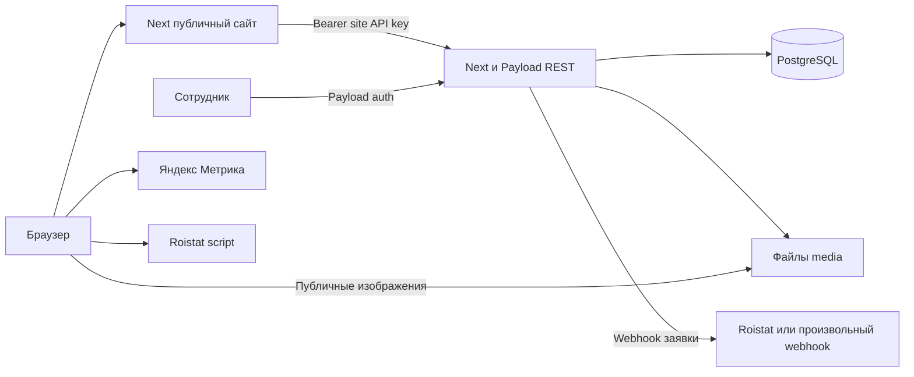
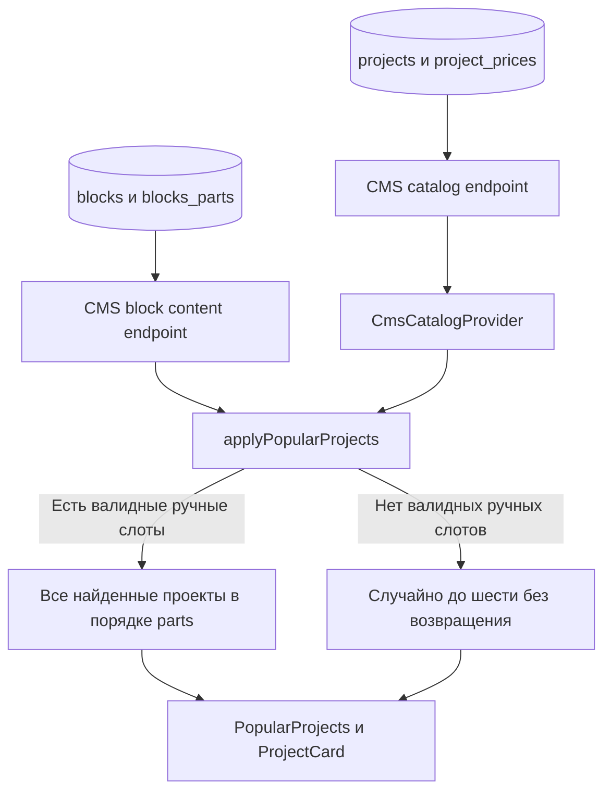
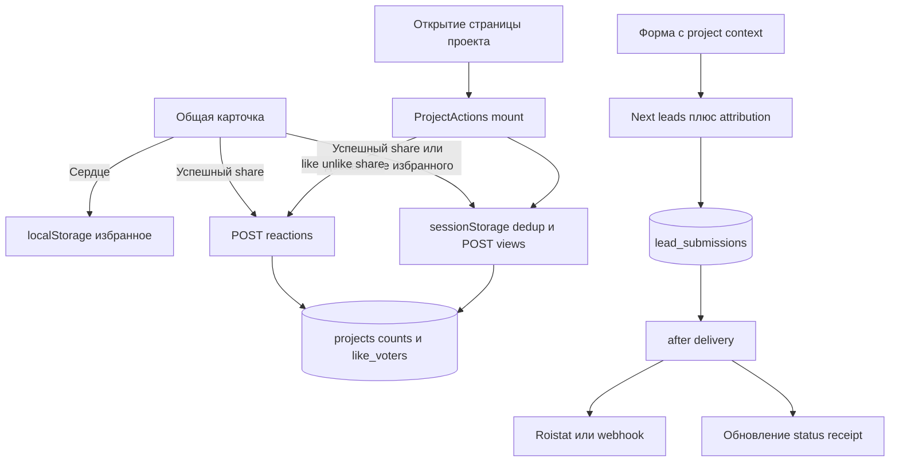

# Технический паспорт проекта: adaptive optimization discovery

Дата: 21.10.2026. Объект: рабочая папка `D:\site`, ветка `main`, HEAD `642cfa3` после ранее выполненного pull. Анализ включает существовавшие до аудита локальные изменения, в частности `src/app/layout.tsx`, `src/app/page.tsx`, `src/lib/share.ts`, `cms/src/data/site-index.json`. Это паспорт исходников рабочей папки, а не подтверждение состояния production avgst.ru.

Метод: чтение исходников, manifest/lock-файлов, SQL-миграций и конфигурации. Приложения, сборки, миграции, интеграции и нагрузочные проверки не запускались; к БД и production подключения не выполнялись. Создан только этот документ. Значения секретов не приводятся. Пути ниже указаны от корня репозитория; `:N` означает проверенную строку, диапазоны описываются в тексте. Документы и комментарии имеют меньший доказательный вес, чем исполняемый код.

Статусы: **Реализовано** — найден исполняемый механизм; **Частично реализовано** — найдена только часть; **Не обнаружено** — поиск в указанной области не нашёл реализации; **Не удалось проверить** — нужны отсутствующие runtime-данные. Наличие кода не доказывает включение механизма в production.

## 1. Executive Summary

1. **Реализовано:** два самостоятельных Next.js-приложения: публичный сайт и Payload CMS, отдельные сборки и зависимости. Сайт получает каталог и контент через серверные HTTP-запросы к CMS; PostgreSQL подключён в CMS через Payload Postgres adapter/Drizzle. Основание: `package.json`, `cms/package.json`, `cms/src/payload.config.ts`, оба Dockerfile.
2. **Реализовано:** опубликованный каталог с устойчивым публичным кодом проекта, медиа, комплектациями и региональными ценами. Это существующий набор кандидатов, но публичная DTO не включает счётчики реакций. Основание: `cms/src/collections/Projects.ts`, `project-catalog-endpoint.ts`, `ProjectPrices.ts` в той же директории.
3. **Частично реализовано:** серверные поведенческие данные представлены агрегатами проекта: `viewCount`, `likeCount`, `shareCount`, JSON-ключами голосов. Журнал событий, показы, позиции и история ранжирования не обнаружены. Основание: `cms/src/collections/project-reactions-endpoint.ts`, `src/lib/project-view.ts`.
4. Критическая семантика: сердце **на карточке** — localStorage-избранное, сердце **на странице проекта** — также серверный like/unlike. Просмотр учитывается не только при открытии страницы, но и при добавлении в избранное/шере на карточке. Поэтому агрегат `viewCount` не равен числу открытий страниц. Основание: `src/components/project-card.tsx:68`, `:76`; `project-actions.tsx:61`; `src/lib/project-view.ts:26`, `:34`.
5. **Реализовано:** заявки постоянно сохраняются в CMS с `formId`, request UUID и JSON-контекстом; затем доставка выполняется через `after()` в тестовый обработчик/webhook/Roistat. Принятие заявки и доставка интеграции — разные состояния. Подтверждение создания сделки Bitrix24 не реализовано в исследованном пути. Основание: `cms/src/collections/LeadSubmissions.ts`, `cms/src/config/lead-intake.ts`, `lead-adapters.ts`.
6. Раздел с техническим ключом `sampling` — **заготовка интерфейса**. Фактическое название в текущем коде уже «Адаптивная оптимизация», маршрут `/sampling` сохранён. В аудите ничего не переименовывалось. Thompson Sampling, Bayesian Ranking и A/B allocation не обнаружены. Основание: `cms/src/config/structure.ts:8`, `cms/src/components/admin/StructureView.tsx:33`.
7. Популярные проекты — ручные слоты CMS либо `Math.random()` без возвращения, максимум шесть в случайной ветке. Выбор не использует поведение. Даже один валидный ручной слот отменяет случайное заполнение остальных. Основание: `src/lib/popular-content.ts`, `cms/src/seed/standard-site.ts:51`.
8. **Частично реализовано:** typed analytics API существует, но после consent-проверки только пишет debug в development; адаптер отправки отсутствует. Реально подключены внешние скрипты Метрики и Roistat, отдельно от этого API. Основание: `src/consent/analytics.ts:96`, `src/components/yandex-metrica.tsx`, `roistat-counter.tsx`, `src/app/layout.tsx`.

## 2. Фактическая архитектура проекта

### Стек и границы

| Слой | Подтверждённая конфигурация | Источник |
|---|---|---|
| Публичный сайт | Next 16.3.0, React/React DOM 19.2.6, TypeScript 5.7.3, App Router, Radix UI, Tabler 3.34.1, Geist 1.4.2 | `package.json`, `package-lock.json` |
| CMS | Next 16.4.0, Payload и официальные адаптеры 3.90.2, React 19.2.6, Lexical, Tailwind 4.3.3, Recharts, ExcelJS 4.4.0 | `cms/package.json`, `cms/package-lock.json` |
| Runtime | Сайт: Node 22.17.0 Alpine в Docker; CMS: Node 22 Bookworm slim; engines соответственно >=22 и >=22.13 | `Dockerfile`, `cms/Dockerfile`, manifests |
| Данные | PostgreSQL, `@payloadcms/db-postgres`, прямой SQL через `req.payload.db.drizzle.execute`; Prisma в исследованном приложении не обнаружена | `cms/src/payload.config.ts`, `cms/src/collections/project-reactions-endpoint.ts` |
| Проверки | Playwright публичного сайта; CMS: tsx/node test, интеграционные тесты, schema drift и migration policy | manifests, `.github/workflows/cms-image.yml` |

Это версии, закреплённые репозиторием, а не установленными production-контейнерами. Workflow использует PostgreSQL 18.6 для CI; версию production PostgreSQL из кода подтвердить нельзя. `src/lib/leads.ts` импортирует Zod, хотя прямой зависимости `zod` в корневом manifest нет; CI отдельно устанавливает его без сохранения. Это наблюдаемая особенность воспроизводимости зависимостей, не проверенный сбой сборки (`.github/workflows/cms-image.yml`, шаг установки общих зависимостей).

Публичные `src/app/**/page.tsx` — преимущественно серверные страницы, интерактивные карточки/формы/калькуляторы — client components. `ProjectCard` фактически содержит `'use client'`, хотя комментарий в `catalog/page.tsx` называет его серверным. Передача готового React-элемента из серверной страницы этого не меняет. Основание: `src/app/catalog/page.tsx`, `src/components/project-card.tsx:1`.

CMS использует официальный Payload RootLayout/RootPage и REST catch-all в `cms/src/app/(payload)`. Админка находится на `/`, API на `/api`, GraphQL отключён. Коллекции защищены staff ACL; отдельные site endpoints используют общий серверный Bearer API key с timing-safe сравнением хешей. Ключ не передаётся в клиентские компоненты. Основание: `cms/src/payload.config.ts`; `cms/src/collections/project-hero-endpoint.ts:4`.

Публичные route handlers: `/next/leads`, `/api/reactions`, `/api/views`, `/api/consent`, `/api/maps-key`, `/api/yandex-rating`, `/api/health`. Основной бизнес-путь использует HTTP POST, а не Server Actions. Server Action обнаружена в CMS layout для штатного Payload server-function bridge (`cms/src/app/(payload)/layout.tsx`).

Значимые для будущего выбора контента особенности: решение популярных выполняется на сервере при запросе; каталог имеет собственное кеширование; часть UI меняется в браузере по региону и выбранной комплектации; содержание страниц гибридное — кодовые layouts плюс CMS overrides. Единого пользовательского контекста для всех этих путей не обнаружено. Основание: `src/app/page.tsx`, `src/lib/popular-content.ts`, `src/app/layout.tsx`, `src/lib/catalog/tier-selection.ts`.

## 3. Карта основных модулей и компонентов

| Область | Основные файлы | Ответственность |
|---|---|---|
| Общая оболочка | `src/app/layout.tsx`, `src/components/site-chrome.tsx` | Consent, регион, внешние счётчики, навигация, вопрос в хедере |
| Главная | `src/app/page.tsx`, `src/lib/home-layout.ts`, `src/components/block-renderer.tsx` | Кодовый layout, hero, популярные, серии, формы |
| Каталог | `src/lib/catalog/types.ts`, `cms-provider.ts`, `fixture-provider.ts`, `filters.ts`; `src/components/catalog-board.tsx` | DTO, получение, фильтрация, UI |
| Страница проекта | `src/app/catalog/[slug]/page.tsx`, `src/lib/catalog/project-*.ts` | Hero, медиа, комплектации, ипотека, похожие, порядок секций |
| CMS content binding | `src/lib/cms/content.ts`, `react-content.ts`; `src/components/cms-content.tsx` | Чтение overrides и подстановка текста/медиа/ссылок |
| Каталог CMS | `cms/src/collections/Projects.ts`, `ProjectPrices.ts`, `project-*-endpoint.ts` | CRUD, черновики, цены, server DTO, реакции |
| Заявки | `src/components/lead-form.tsx`, `lead-dialog.tsx`, `lead-reveal.tsx`, `panel-lead-form.tsx`; `src/lib/submit-lead.ts` | UI и общий клиент отправки |
| Приём и доставка | `src/app/next/leads/route.ts`, `cms/src/collections/LeadSubmissions.ts`, `cms/src/config/lead-intake.ts`, `lead-adapters.ts` | Валидация, атрибуция, receipt, внешняя доставка |
| Реакции | `src/components/project-actions.tsx`, `project-card.tsx`, `src/lib/reactions.ts`, `project-view.ts`, `favorites.ts` | Серверные агрегаты и локальное избранное |
| Семплирование | `cms/src/config/structure.ts`, `cms/src/components/admin/StructureView.tsx` | Только запись навигации и пустая страница |
| Эксплуатация | Dockerfiles, `.github/workflows/cms-image.yml`, `cms/docker/entrypoint.sh`, `cms/scripts/release-migrate.mjs` | Образы, проверки, отдельная команда миграции |

## 4. Текущее состояние раздела «Семплирование»

**Частично реализовано:** технический key `sampling`, custom admin view `/sampling`, legacy redirect `/structure/sampling` → `/sampling`, иконка Flask, проверка наличия `req.user`. Фактический title — «Адаптивная оптимизация», description — «Раздел адаптивной оптимизации сайта». Страница выводит только h1 и описание. При `view === 'sampling'` запросы проектов/заявок/настроек не выполняются: они ограничены другими ветками view. Источники: `cms/src/payload.config.ts:51`, `cms/src/components/admin/LegacyRoutes.tsx:8`, `StructureView.tsx:18`, `:33`, `:47`, `cms/src/config/structure.ts:8`.

| Возможность | Статус |
|---|---|
| Навигация и защищённый экран | Реализовано |
| Настройки алгоритма, кандидаты, связь с каталогом | Не обнаружено в sampling view |
| Выбор вариантов, Thompson/Bayesian/A/B | Не обнаружено в `src`, `cms/src` |
| Сохранение результатов и статистических параметров | Не обнаружено в коллекциях/миграциях/обработчиках |
| Экспериментальные exposure/conversion типы | Частично реализовано только как TypeScript union в `src/consent/analytics.ts` |

`docs/сэмплирование Томпсона.md` — существующий локальный документ с концепцией и кандидатами, прямо говорит «Код не меняется». Это не реализация. Его таблица сигналов частично устарела относительно текущего `project-view.ts`, где уже есть серверный view aggregate.

Структурный вывод: экран не связан алгоритмом или схемой с одной конкретной задачей, потому что соответствующих сущностей вообще нет. Он находится внутри расширяемой системы custom admin views, но это ещё не подсистема оптимизации. Возможность добавить функциональность — вывод о существующей точке подключения, а не утверждение о готовом framework экспериментов.

## 5. Модель данных каталога

### Проект, идентичность и публикация

Коллекция `projects`, внутренний numeric id; `recordType` — `project` или `ready-home`; `slug` уникален; `code` — уникальный индексируемый публичный восьмизначный буквенно-цифровой код; `importKey` уникален и сохраняет историческую связь `catalog:<slug>`. Код выдаётся при создании, удаляется из update payload, остаётся зарезервированным после удаления проекта в отдельной SQL-таблице `product_codes`. Формат кода: восемь заглавных букв/цифр, ровно две цифры. Источники: `cms/src/collections/Projects.ts`, `record-id.ts`, `cms/src/migrations/20261014_164500_product_code.ts`.

**Не путать идентификаторы:** публичный `CatalogProject.cmsId` содержит `record.code`, а не numeric Payload id. `CatalogProject.id` содержит снятый префикс `importKey`, либо `cms:<numeric id>`. `slug` — изменяемый адрес. Заявки используют `projectId` для публичного кода, `projectExternalId` для фронтенд-id. Реакции адресуются по slug или importKey. Основание: `cms/src/collections/project-catalog-endpoint.ts`, `src/lib/leads.ts`, `cms/src/collections/project-reactions-endpoint.ts`.

**Реализовано:** drafts и максимум 20 версий документа. Публичный catalog endpoint выдаёт только `_status=published`; снятая с публикации запись исключается при следующем обновлении данных. Публичная страница hero сначала ищет проект через этот же каталог, поэтому отдельный старый `/hero` endpoint не определяет основной публичный путь. Источники: `Projects.ts`, `project-catalog-endpoint.ts`, `src/lib/catalog/project-hero.ts`.

### Состав

| Группа | Фактические поля/механизм |
|---|---|
| Характеристики | name, areaValue, floorsValue, bedrooms, bathrooms, technologyBadge, series |
| Группировки | series: panel/barn/classic/modular/aframe; technology выводится из technologyBadge; ready-home задаёт тип записи |
| Обложка/hero | desktopImage/mobileImage uploads → media; старые imageUrl/mobileImageUrl — fallback |
| Медиа | exteriors/interiors, built фото/видео, floorPlans, plans с floors и rooms; upload references и legacy URL |
| Описание | description, searchDescription, about: title/text/image; публичный catalog description выбирает searchDescription либо name |
| Комплектации | configurations: key/name/price/lead/mortgage/includes/gifts/details; maxRows 3, набор зависит от технологии; legacyConfigurations архивирует неподходящие старые строки |
| Дополнительные опции | options: key/name/price/defaultSelected; публичный catalog endpoint сейчас отдаёт options пустым массивом |
| Цена | priceAmount, комплектации, отдельные project-prices, readyHome.salePrice |
| Готовый дом | location, salePrice, configurationLead, configuration, sections, visitImage |
| Представление | blockOrder, nextStepsSettings, скрытые source flags для источников отдельных секций |
| Агрегаты | likeCount/shareCount/viewCount, likeVoters/shareVoters |

Основание: `cms/src/collections/Projects.ts`, `src/lib/catalog/types.ts`, `cms/src/collections/project-catalog-endpoint.ts`.

Серии — enum, отдельные коллекции категорий/подборок/связей project-to-project в конфигурации Payload не обнаружены. Подборки формируются фильтрами и редакционными слотами, а похожие проекты вычисляются по признакам. Страница проекта исключает текущий id, сортирует по сумме: другая серия +1000, технология +250, разница площади ×2, этажей ×80, спален ×40, затем берёт 6. Это детерминированная эвристика сходства, не обучение на событиях (`src/app/catalog/[slug]/page.tsx`, функция `similarityScore`).

### Цены и ипотека

`project-prices`: обязательная relationship на projects, configuration, region, положительная целая price, JSON history. Уникальный `lookupKey = numericProjectId:configuration:region`. Есть импорт и marketing price preview. Типы цен: nn/msk публичные, special/special-msk/dealer/special-dealer внутренние. Стандартная цена из регионального прайса имеет приоритет в catalog endpoint; nn при отсутствии дополняется вычисленной базовой ценой. Источники: `cms/src/collections/ProjectPrices.ts`, `cms/src/config/price-kinds.ts`, `catalog-price.ts`, `project-catalog-endpoint.ts`.

Ипотечная программа и расчёт — код в `src/lib/mortgage/*`; в проекте `mortgage` — признак доступности комплектации, CMS mortgage summary — UI, а не коллекция кредитных офферов. Регион и общая выбранная комплектация влияют на клиентское отображение. Параметры расчёта попадают в заявку, но самостоятельное хранение каждого расчёта не обнаружено (`src/components/mortgage-calculator.tsx:284`, `src/lib/catalog/tier-selection.ts`).

### Получение и фильтрация

`CmsCatalogProvider` читает `/api/projects/catalog`, затем использует `FixtureCatalogProvider` как алгоритм фильтрации над **данными CMS**. Название Fixture не означает fallback на полный fixture-каталог: при ошибке CMS `readCatalog` возвращает `[]`, который явно передаётся конструктору. Фильтры: текст, ready, серия, технологии, диапазоны площади/цены, спальни/санузлы/этажи. URL парсится и канонизируется в `filters.ts`; результат делится на подходящие items и rest, rest сортируется по числу несоответствий и площади. `siteCode` есть в контракте, но tenant-фильтрация в этом провайдере не реализована. Источники: `src/lib/catalog/cms-provider.ts`, `fixture-provider.ts`, `filters.ts`, `types.ts`.

Основной каталог дополнительно перемешивает подходящие проекты Fisher–Yates на сервере; это не редакционный или статистический рейтинг. Для ready-фильтра rest скрывается (`src/app/catalog/page.tsx`, `shuffled`, `CatalogBoard`).

**Пригодность кандидатов:** опубликованные DTO уже содержат id/код, адрес, признаки, обложку и цену; их можно технически перечислить. Однако текущая выборка не исключает ready-home из популярных, не гарантирует наличие цены/картинки, не содержит признаков exposure/эксперимента и счётчиков. Это ограничения фактического контракта, не предложение новой схемы.

## 6. Архитектура блока популярных проектов

Полный путь: PostgreSQL projects + project_prices → Payload `/api/projects/catalog` → server `CmsCatalogProvider.list` → `applyPopularProjects` → `BlockRenderer` → client `PopularProjects` → общий `ProjectCard`. Параллельно PostgreSQL blocks/blocks_parts → `/api/blocks/content?key=popularProjects` → heading/button/slot href.

Основание: `src/app/page.tsx`, `src/lib/popular-content.ts`, `src/components/block-renderer.tsx`, `popular-projects.tsx`.

Шесть фиксируется в двух местах: `sample(items, 6)` на сайте и seed slots `[0,1,2,3,4,5]` в `cms/src/seed/standard-site.ts:51`. Ручной путь фильтрует parts по regex `popularProjects.slot.\d+`, разрешает `href` через `item.cmsId`, сохраняет **порядок массива parts**, а не сортирует по цифре слота. Отдельного `.slice(0,6)` и dedup в ручной ветке нет. Если валиден один слот, вернётся один проект: пустые позиции не дозаполняются, несмотря на комментарий «Empty slots take a fresh random six» (`src/lib/popular-content.ts`).

Редактор CMS поддерживает выбор проекта и поиск (`cms/src/components/admin/PageBlockComposition.tsx:299`). Preview обновляет heading/button/projects через postMessage с allowlist origin; это редакторский preview, не пользовательская выдача вариантов (`src/components/popular-projects.tsx`).

Карточки общие для mobile/desktop: один компонент, grid/CSS; отдельные desktop/mobile ссылки «Все проекты», а не отдельные алгоритмы. `ProjectCard` использует desktop `imageUrl`, хотя DTO содержит mobileImageUrl. Цена зависит от региона в браузере. Переходы — обычные `<a>`, без source/position click event. Показ карточки не регистрируется. Фавориты и шеринг описаны ниже.

Кеширование: блок и каталог запрашиваются с `next.revalidate=60`, CMS отвечает `Cache-Control:no-store`; React cache убирает повторы в серверном render-контексте. Результат случайного выбора отдельно не сохраняется; sticky assignment посетителю не обнаружен. Нельзя приравнять TTL fetch к неизменности всей выдачи на 60 секунд (`src/lib/popular-content.ts`, `src/lib/catalog/cms-provider.ts`).

## 7. Инвентаризация пользовательских событий

| Действие | UI/вызов | Реальная регистрация | Постоянное хранение | Аналитические границы |
|---|---|---|---|---|
| Показ карточки | ProjectCard во всех списках | Не обнаружено | Не обнаружено | Нет знаменателя показов, позиции, видимости |
| Клик из популярных/каталога/похожих/подборки | `<a href>` общей карточки | Собственное событие не обнаружено | Нет собственного click log | Источник блока и позиция не передаются |
| Открытие проекта | `ProjectActions` mount | POST `/api/views` | Только projects.view_count | Не уникальный пользователь; JS-mount, а не HTTP page request |
| Сердце карточки | toggleFavorite | localStorage; при добавлении вызывается view | В браузере; на сервере только view aggregate | **Не серверный лайк** |
| Лайк страницы | `ProjectActions.onFavorite` | POST reactions like/unlike | like_count + like_voters JSON | Нет времени, места и истории изменения |
| Успешный шер карточки | shareProject → recordCardShare | POST reactions share и затем session view | share_count, возможно view_count | Успех Web Share либо копирование, не факт отправки адресату |
| Успешный шер страницы | shareProject → sendReaction | Аналогично share; view после успешной реакции | Те же агрегаты | Нет канала/получателя/source/позиции |
| Открытие формы | Dialog/Reveal/Panel state | Собственная отправка события не обнаружена | Не обнаружено | Не восстановить воронку open→submit |
| Отправка принятой формы | submitLead → API → CMS | Сохранён lead-submission | requestId/formId/status/payload/timestamps | Нет общего event stream |
| Внешняя доставка | after → webhook | status sent/test/failed | Статус receipt | sent означает HTTP успех интеграции |
| Повторное обращение | Новый UUID при новой попытке/новом payload | Новый receipt; одинаковый UUID дедуплицируется | Отдельная заявка | Нет признака repeated visitor/lead по человеку |
| Расчёт/выбор ипотечной программы | trackEvent calls | Только dev debug после consent | Не обнаружено | Снимок расчёта сохраняется только в отправленной заявке |

Основание: `src/components/project-card.tsx:68`, `:76`; `project-actions.tsx:61`; `src/lib/project-view.ts:26`, `:34`; `favorites.ts`; `share.ts`; `src/consent/analytics.ts:96`; `src/components/mortgage-calculator.tsx:209`, `:318`, `:337`, `:361`, `:778`, `:797`; `cms/src/config/lead-intake.ts`.

### Уникальность и достоверность реакций

`avgst-session-views` хранит список slug в sessionStorage, один count на slug за сессию вкладки. При неуспехе HTTP slug освобождается для повторной попытки. Нет серверного sessionId/visitorId в POST views; повторные прямые POST сервер не дедуплицирует. Ошибка недоступного sessionStorage при claim не перехвачена. При смене slug идентичность browser-dedup также меняется (`src/lib/project-view.ts`).

Лайки: сервер создаёт `avgst_voter` (random 16 bytes hex), HttpOnly/SameSite Lax, Secure в production, срок 365 дней. Ключи `c:<cookie>` и `f:<HMAC(device signals)>`; fingerprint использует user-agent, язык, timezone, screen/DPR, cores, без IP. SQL атомарно добавляет голос, только если ни один ключ не содержится в JSON; unlike удаляет переданные ключи и уменьшает count не ниже нуля. Нет отдельного unique index на каждую пару project/voter: защита реализована conditional UPDATE JSONB. Это приближение устройства, не проверенная уникальность человека. Изменение сигналов/удаление cookie не эквивалентны авторизованной личности (`src/lib/reactions.ts`, `src/app/api/reactions/route.ts`, `cms/src/collections/project-reactions-endpoint.ts`).

Шеры намеренно без dedup: action share отправляет пустые voter keys, каждый успешный вызов увеличивает счётчик. Поле shareVoters присутствует, но текущий addShare его не заполняет. Счётчики SQL обновляют основную строку projects; это не отдельные event rows или версии реакции. Projects beforeChange удерживает старые агрегаты при редакторском сохранении (`Projects.ts`, `project-reactions-endpoint.ts`).

## 8. Инвентаризация форм и заявок

### Общий контракт

`LeadForm` отправляет name, phone, message, consent, siteId, pageId, projectExternalId, projectId, formId, sourceUrl, sourcePath, meta. Через `ProjectLeadProvider` на странице проекта автоматически добавляются code/id/slug/name. `meta` включает region и formHeading, затем caller overrides. Портал диалога сохраняет React context. На общих страницах контекст проекта отсутствует. Основание: `src/components/lead-form.tsx:99`, `project-lead-context.tsx`, `lead-dialog.tsx`.

Все строки таблицы идут через `submitLead` → `/next/leads` → CMS `/api/lead-submissions/submit` → постоянный receipt → configured delivery. Это подтверждённый общий путь; фактические включённые настройки не проверялись.

| Форма | Компонент/место | formId | Проект и комплектация | Специфичные данные |
|---|---|---|---|---|
| Вопрос в хедере | site-chrome; project-hero-content | header-question | По ProjectLeadProvider, если на странице проекта; комплектация не обещана | message, pageTitle; project hero добавляет project name |
| Общая консультация | LeadDialog default/LeadDialogButton | consultation-dialog | По контексту | heading/meta caller |
| Консультация по ипотеке | finance-lead-card, mortgage-page | mortgage-consultation | Зависит от контекста, не обязательный проект | Метаданные вызова/программы |
| Ипотечный калькулятор | mortgage-calculator, panel и обычный reveal | mortgage-calculator | project id/context при проектном калькуляторе; panel добавляет выбранный tier | calc_mode, program, property_price, down_payment, term_years, monthly_payment, loan_amount, is_combined, construction_region, children_count, subsidy_months, remaining_after_subsidy, parts |
| Получить расчёт комплектации | ProjectConfig → PanelLeadForm | project-configuration (default PanelLeadForm) | external id + context code; tier передаётся названием | project name, tier, price |
| Выставочный дом | ProjectNextSteps | exhibition-visit | По контексту текущего проекта | pageTitle |
| Архитектор | ProjectNextSteps | architect-consultation | По контексту | heading/caller context |
| Контакты | ContactsSection в block-renderer | contacts-question | На странице проекта передаются явно project/context | message, source URL, heading |
| Экскурсия на производство | manufacture page, block-renderer | factory-tour | На обычной manufacture не обязателен | caller heading/context |
| Предложение готового дома | ReadyHomeOffer → PanelLeadForm | ready-home-offer | external id + context | project, location, price, kind=ready-home |
| Промо hero | HeroCarousel → LeadDialog | CMS formKey либо hero-promo | home pageId; проект не обязателен | promo heading |
| День открытых дверей | factory-open-day/form.tsx, отдельная форма | FactoryOpenDayForm | Проект не передаётся | email, event=factory-open-day, date, sourceUrl/sourcePath |
| Реферальная программа | referral-program.tsx, отдельная форма | referral-program | projectExternalId используется как `referral:<email>`, **не id проекта** | name/phone/consent, sourcePath с #referral; sourceUrl дополняется сервером Referer |
| Универсальная LeadForm без formId | lead-form.tsx | lead-form | По контексту | Общий fallback, не отдельный доказанный бизнес-сценарий |

Источники таблицы: `src/components/site-chrome.tsx:545`, `project-hero-content.tsx:58`, `finance-lead-card.tsx:83`, `mortgage-page.tsx:355`, `:418`, `mortgage-calculator.tsx:284`, `:603`, `:637`, `project-config.tsx:205`, `panel-lead-form.tsx` (default formId), `project-next-steps.tsx:131`, `:142`, `block-renderer.tsx:287`, `:409`, `src/app/manufacture/page.tsx:61`, `ready-home-offer.tsx:56`, `hero-carousel.tsx:667`, `factory-open-day/form.tsx:46`, `referral-program.tsx:123`.

Для всех перечисленных форм: тип/место вызова определяется прежде всего `formId`, URL и metadata; **отдельного события открытия с timestamp/id нет**. Источник отправки фиксируется URL/path, но source открытия не хранится отдельным объектом. Одинаковый formId у разных placement не даёт уникального placement. Выбранная комплектация — не обязательное поле схемы и передаётся только соответствующими callers, часто текстовым tier, без стабильного tier id.

### Приём, CRM и повторы

Сервер валидирует Zod schema и обязательный formId, добавляет атрибуцию; in-memory rate limiter — 5 попыток за 10 минут на первый x-forwarded-for либо `local`. Это локально для процесса, без общей Redis/SQL-квоты. Клиент удерживает UUID для неизменённого сериализованного payload; ref-блокировка и status предотвращают двойной submit одного экземпляра UI. В CMS `requestId UNIQUE`, при конфликте читается существующий receipt. Это идемпотентность попытки, не дедупликация по телефону/проекту/человеку (`src/lib/leads.ts`, `submit-lead.ts`, `src/app/next/leads/route.ts`, `cms/src/config/lead-intake.ts`).

Если доставка отключена, CMS возвращает 503 до сохранения. Если включена: создаёт pending receipt, отвечает 202 accepted, после ответа вызывает `after()`. Сбой внешней передачи даёт failed; успех HTTP — sent, test mode — test. Тело webhook содержит id/title/name/phone/email/comment/page/form/project, UTM и полный lead. Roistat получает roistat_visit; создание сделки в Bitrix24 делегировано внешнему Roistat по описанию настройки. Прямой CRM SDK/Bitrix API в этом пути, CRM deal id/status и обратное подтверждение коммерческого исхода не обнаружены (`LeadSubmissions.ts`, `lead-adapters.ts`).

Очередь с устойчивыми заданиями, автоматические retries/backoff/dead-letter не обнаружены. `after()` — фоновое выполнение внутри Next runtime, а не отдельный worker. Сохранённый pending/failed receipt не равен автоматически запланированному повтору.

Связать заявку с проектом можно по code, meta.projectSlug либо legacy external id. Такой join уже выполняет `cms/src/config/catalog-lead-counts.ts`: пропускает failed, но учитывает pending/test/sent; общий счётчик вычисляется при чтении каталога в админке, по всем submissions, без весов типов форм и без временного окна. Поэтому это число обращений, а не число сделок/продаж. Последовательность предыдущих действий к заявке не присоединяется.

## 9. Существующие аналитические механизмы

| Механизм | Статус и фактическая роль | Источник |
|---|---|---|
| Typed trackEvent | Частично реализовано: union типов, analytics consent guard, top-level PII key guard, только development console.debug; сеть/БД не подключены | `src/consent/analytics.ts:96` |
| Вызовы ипотечной аналитики | Реализованы calls: calculator open, program selected, parameters changed, calculation completed, project/catalog clicked; заканчиваются заглушкой adapter | `src/components/mortgage-calculator.tsx` |
| Яндекс.Метрика | Скрипт init, webvisor/clickmap/trackLinks, ecommerce имя dataLayer; SPA hit при изменении pathname/query, первый hit не дублируется | `src/components/yandex-metrica.tsx` |
| Roistat | Скрипт init/module, page/referrer, cookie visit для атрибуции заявок | `src/components/roistat-counter.tsx` |
| Собственные проектные агрегаты | Реализовано SQL increment/conditional update | `cms/src/collections/project-reactions-endpoint.ts` |
| Аудит согласий | JSONL на локальном диске либо console fallback | `src/app/api/consent/route.ts` |

Настройка Метрики/Roistat хранится в global lead-delivery, публичные counter endpoints, чтение сервером и props в root layout. Оба внешних скрипта подключаются при наличии счётчика **без проверки analytics consent** в этих компонентах/layout. Это отличается от consent-gated trackEvent; правила единого аналитического контура сейчас неоднородны. Наличие cleanup prefixes `avgst_experiment_`/`avgst_optimization_` не доказывает allocation или хранение эксперимента (`src/app/layout.tsx`, `src/consent/cleanup.ts`).

В собственном коде не обнаружены отправка reachGoal для рассматриваемых форм, ecommerce push для проектов, импорт отчётов Метрики/Roistat в PostgreSQL или общий ingestion API событий. Настройки внешних целей, объём и доступность истории в кабинетах **не удалось проверить**. Нельзя считать внешние clickmap/Webvisor готовым локальным журналом с projectId/placement/position.

## 10. Идентификация посетителей и атрибуция

| Идентификатор/хранилище | Срок/область | Назначение и ограничение |
|---|---|---|
| avgst_voter, HttpOnly cookie | 365 дней, path / | Голосование; не передаётся в lead payload и view POST |
| HMAC device key | Сохраняется в likeVoters проекта | Дедуп likes; не единая сессия, не аккаунт |
| avgst-session-views, sessionStorage | Сессия вкладки | Список slug, без серверного session id |
| avgst:favorites, localStorage | До удаления/отзыва functional storage | Только frontend ids, серверной коллекции избранного нет |
| avgst:project-tier, localStorage | До удаления | Выбранная комплектация общая; не журнал и не per-project event |
| avgst_lead_attribution, HttpOnly cookie | Session cookie: maxAge не задан | Последний захваченный набор разрешённых query параметров и landing_page |
| roistat_visit, _ym_uid | Управляются внешними скриптами | Прикладываются к заявке при наличии/валидности; сроки из репозитория не гарантированы |
| avgst_cookie_consent | До 12 месяцев, версия согласия | Категории necessary/functional/analytics/marketing |
| requestId заявки | UUID одной попытки | Идемпотентность, не visitor identity |
| Staff users sessions | JWT срок 30 дней, useSessions | Только сотрудники CMS, не публичные посетители |

Основание: `src/lib/reactions.ts`, `src/app/api/reactions/route.ts`, `src/lib/project-view.ts`, `favorites.ts`, `catalog/tier-selection.ts`, `lead-attribution.ts`, `src/proxy.ts`, `src/consent/types.ts`, `cms/src/collections/Users.ts`.

Proxy захватывает utm_source/medium/campaign/content/term/referrer, yclid, gclid, _ym_uid; ограничивает значения, исключает next-router-prefetch. Установленный cookie хранит также landing_page; новый захват заменяет весь объект. В `/next/leads` текущий URL с UTM имеет приоритет как новый источник; иначе объединяется saved attribution и текущие разрешённые query. _ym_uid из cookie имеет приоритет, roistat_visit проверяется и добавляется как meta.roistatVisit. Это реализация source attribution заявки, не полный first-touch/last-touch журнал и не история переходов (`src/lib/lead-attribution.ts`, `src/proxy.ts`).

**Не обнаружено:** общая таблица visitors/sessions, сквозной event id/sequence, объединение voter cookie с roistat/session/receipt, авторизация публичного посетителя. Поэтому путь «увидел популярную карточку на позиции N → открыл → выбрал tier → отправил форму» из собственных данных достоверно не восстанавливается.

## 11. Схема данных Payload и PostgreSQL

Это логическая модель по коллекциям и последовательности миграций; актуальная live schema, размеры таблиц, наличие реально применённых индексов/миграций **не удалось проверить**.

| Сущность | Хранение и связи |
|---|---|
| projects | Основные поля проекта, _status, code, import_key, upload FK на media, nextStepsSettings и source flags, blockOrder по определению коллекции |
| projects_* | Дочерние массивы: exteriors, interiors, built, floor_plans, plans/floors/rooms, configurations/includes/gifts/details/groups/items, options, about, ready_home_configuration/sections/points/items |
| _projects_v и _projects_v_version_* | Версии/черновики проекта и вложенных массивов; отдельные version_* поля реакций существуют в миграциях, но SQL increment идёт в projects |
| project_prices | FK project → projects; lookup_key UNIQUE; configuration/region/price/history |
| media | Метаданные/filename/url/dimensions/thumbnail; сами файлы на staticDir, не бинарные данные PG |
| pages/pages_layout/pages_rels | route UNIQUE, kind/metaTitle, полиморфные layout relationships на blocks/forms, overrides, redirect; версии _pages_v и дочерние таблицы |
| blocks/blocks_parts/blocks_rels | key UNIQUE, defaults JSON, content parts, media/form relationships; конфигурационные шаблоны имеют дочерние cfg_p_*/cfg_m_* таблицы в initial SQL |
| forms/forms_parts | Реестр компонентов форм и content; это не таблица ответов пользователя |
| lead_submissions | request_id UNIQUE, form_id text, status enum, payload JSON, title, created_at/updated_at; project relation внутри JSON, не отдельный нормализованный FK |
| lead_delivery | Payload global: режимы отправки, счётчики Roistat, Метрика, карты |
| stories и дочерние/версионные таблицы | Отзывы и медиа/related card, добавленные миграциями 19.10; не behavioural events |
| users/users_sessions | Сотрудники, роли, блокировка, auth/session данные |
| product_codes | Отдельный SQL registry: code PK + CHECK формата + timestamp; не Payload collection |
| payload_* | payload_kv, payload_locked_documents и rels, payload_preferences и rels, payload_migrations |

Источники: `cms/src/payload.config.ts`; все определения `cms/src/collections/{Projects,ProjectPrices,Media,Structure,LeadSubmissions,Stories,Users}.ts`; `cms/src/migrations/20261014_074208_initial_record_ids.ts:407` (начало project arrays), `:579` (projects), `:868` (prices), `:879` (submissions), `:889` (media), `:913` (служебные таблицы); последующие миграции, перечисленные в `cms/src/migrations/index.ts`.

Индексы, подтверждённые SQL: users.email UNIQUE (:1090 initial); pages.route/import_key UNIQUE (:1093); blocks.key UNIQUE (:1176); forms.key UNIQUE (:1185); projects.slug/import_key UNIQUE (:1234/:1237); project_prices.lookup_key UNIQUE (:1298); lead_submissions.request_id UNIQUE (:1302); media.filename UNIQUE (:1307); payload_kv.key UNIQUE (:1309). Дочерние массивы имеют индексы order/parent; версии — parent/timestamps/status. Код проекта добавлен UNIQUE индексом `projects_code_idx`, статус — `projects__status_idx` в product_code migration; upload FK и индексы blocks/forms parts images добавлены hero_background migration. Нормализованные уникальные event/voter keys, временные индексы event stream, retention partitions не обнаружены.

Миграции реакций: `20261015_235500_project_reactions.ts` добавляет numeric counts и JSONB voters; `20261017_201500_project_views.ts` — numeric view_count. Ни event timestamp, ни origin/position/variant в этих изменениях нет.

Payload управляет коллекциями/глобалом/версиями; SQL вне стандартного CRUD используется для агрегатов и registry product_codes. Вне PostgreSQL находятся local/sessionStorage посетителя, cookies, media files, JSONL consent audit, кодовые fixtures/layouts и внешние системы. Собственная коллекция аналитических событий, таблица exposures, агрегаты по суткам/позициям/вариантам не обнаружены в registered collections/миграциях.

Миграции зарегистрированы явно, production schema push выключен; dev push разрешён только при PAYLOAD_DB_PUSH=true. Релизная миграция отделена от serve, использует проверку ожидаемой БД, advisory lock, историю payload_migrations и policy. CI применяет миграции к пустой PG и запускает schema drift check. Это описание кода, эти команды в аудите не выполнялись (`cms/src/payload.config.ts`, `cms/docker/entrypoint.sh`, `cms/scripts/release-migrate.mjs`, `migration-policy.mjs`, `.github/workflows/cms-image.yml`).

## 12. Возможности конфигурации интерфейса

| Элемент | Фактическая конфигурация | Граница |
|---|---|---|
| Фото/обложки | desktop/mobile upload + галереи нескольких изображений | Несколько файлов не равны экспериментальным arms; отдельной независимой cover variant сущности нет |
| Карточки | Общий ProjectCard, showPrice/locationLabel props, региональная цена | Структура/CTA choice задаются кодом и copy, не random variant policy |
| Тексты/ссылки/картинки | blocks.parts и React content binding, scope по route | Один сохранённый набор overrides, не visitor assignment |
| Hero | CMS parts, изображения desktop/mobile, promo action link/form и relationship на form | Редакторские промо/слайды, а не A/B allocation |
| Популярные | Шесть редакционных слотов, heading/button | Нет автоматической оптимизации/отчёта вариантов |
| Цена против платежа | Карточка показывает стоимость; hero/project calculator считают платёж по tier | Одновременно существующие разные компоненты, не механизм тестирования вариантов |
| Порядок секций | projects.blockOrder, `/api/projects/page-order`, валидация полного набора; contacts закреплён в конце | Порядок проекта общий, не назначение посетителю |
| Следующие шаги | enabled/visitEnabled/secondaryEnabled/order | Настройки блока, не feature flag framework |
| Layout страниц | pages.layout с blocks/forms и overrides | Главная фактически строится из HOME_LAYOUT с выборочными CMS overrides; не любой сохранённый layout автоматически определяет весь runtime |

Основание: `cms/src/collections/Projects.ts`, `Structure.ts`, `src/lib/cms/react-content.ts`, `src/lib/hero-content.ts`, `src/components/hero-carousel.tsx`, `src/lib/catalog/page-order.ts`, `src/app/page.tsx`, `src/components/project-card.tsx`.

Experiment/variant поля объявлены в analytics union, cleanup знает соответствующие prefixes. **Не обнаружено:** CRUD экспериментов, arms, weights, assignment, targeting, feature flag provider, sticky bucketing, exposure storage, statistical updates. Большинство требуемых будущих альтернатив не подтверждены данными: без БД нельзя установить, какие изображения/тексты реально заведены редакторами.

## 13. Кеширование и производительность

| Механизм | Факт/ограничение |
|---|---|
| Request-time rendering | RootLayout читает cookies/headers; CMS catalog/parts используют connection(); основные CMS страницы зависят от запроса |
| Fetch caching | catalog/popular/hero/series/stories/settings: next.revalidate=60; общий React content, project configurations/media/order, реакции — no-store по соответствующим readers |
| React cache | memoization server reads в catalog/popular/content/hero; это не SQL materialized aggregate и не общий visitor cache |
| Дополнительный cache | hero inline previews unstable_cache TTL 86400; yandex rating fetch 3600 |
| CMS HTTP headers | custom content/catalog endpoints no-store; media file header max-age=2592000 |
| Инвалидация | clearPublicMediaCache при изменении blocks; tag/path revalidation публичного каталога при publish в просмотренных hooks не обнаружена |
| Postgres pool | max 10, connect timeout 5s на CMS process; число процессов в production неизвестно |
| Каталог | pagination:false для проектов и прайсов, join/filter на массивах; цены повторно ищутся для каждой записи |
| Admin lead counts | Загружает все submissions и ищет соответствующий проект; не SQL aggregate/materialized view |
| Реакции | Атомарный UPDATE одной строки проекта; likeVoters JSONB растёт в этой строке, выполняются membership проверки; отдельный GIN на voters не обнаружен |
| Background | after для доставки; cron/устойчивая очередь/планировщик ranking jobs не обнаружены |
| Rate limit | In-memory Map одного процесса; не общий лимит нескольких реплик |

Источники: `src/app/layout.tsx`, `src/lib/catalog/cms-provider.ts`, `src/lib/popular-content.ts`, `src/lib/cms/content.ts`, `src/lib/hero-content.ts`, `src/app/api/yandex-rating/route.ts`, `cms/next.config.ts`, `cms/src/collections/Structure.ts`, `cms/src/payload.config.ts`, `project-catalog-endpoint.ts`, `project-reactions-endpoint.ts`, `cms/src/components/admin/StructureView.tsx`, `src/lib/leads.ts`.

Точные runtime cache hit/miss и задержка публикации не проверены. Одновременное наличие `next.revalidate=60` у вызывающего fetch и `Cache-Control:no-store` в ответе CMS нужно рассматривать как два разных уровня; гарантированное мгновенное обновление или строго 60-секундную stale window аудит не устанавливает. Системы общей инвалидации между репликами/внешнего cache handler в просмотренной конфигурации не обнаружены.

Оба приложения собираются standalone, контейнеры работают непривилегированно, имеют healthchecks. У CMS media — локальный каталог; uploads production разрешены только с configured persistent storage flag и абсолютным media dir. S3 storage adapter в payload config не подключён. JSONL согласий без гарантированного volume зависит от writable FS экземпляра. Наличие reverse proxy/CDN и настройки маршрутизации живого сайта по локальному Dockerfile установить нельзя. Документация описывает Dokploy/Swarm, workflow — сборку/публикацию/релиз CMS; число реплик, CDN policies, backup и фактические mounts **не удалось проверить** (`Dockerfile`, `cms/Dockerfile`, `cms/src/config/environment.ts`, `.github/workflows/cms-image.yml`, `cms/README.md`).

Журналирование: Payload level warn с redact auth/cookie/secret fields, обезличенная ошибка доставки; `/api/health` публичного сайта, CMS health и ready. Readiness CMS реализована отдельным route с Payload/проверкой миграций. Consent audit при недоступном диске возвращает ok и логирует только id/action: receipt API не гарантирует файл на диске. Центральный event warehouse, tracing/metrics SDK, Sentry в исследованных исходниках не обнаружены (`cms/src/payload.config.ts`, `cms/src/app/api/ready/route.ts`, `src/app/api/consent/route.ts`).

## 14. Существующие механизмы, потенциально пригодные для повторного использования

Это инвентаризация точек интеграции, не проект целевой системы.

| Механизм | Что уже доступно | Ограничение |
|---|---|---|
| Catalog provider/DTO | Перечисление published candidates и фильтры | Нет статистики/eligibility policy в контракте |
| Публичный product code | Устойчивый код и reserve registry | Рядом используются slug и legacy frontend ids |
| Popular slots | Редакторское управление и готовый render path | Неполные слоты не дополняются, нет exposure |
| Project aggregates | Существующие like/share/view counts | Нельзя восстановить времена, позиции и воронку |
| Lead receipts | Долговременные типизированные formId и JSON-контекст, UUID dedup | Не гарантируют CRM deal и уникального человека |
| Attribution helper | UTM/ad ids/roistat visit в lead metadata | Не соединён с reactions/views |
| CMS content parts | Тексты, изображения, ссылки, preview | Только текущий редакционный вариант |
| Custom admin views | Точка sampling уже существует | Нет backend-модели оптимизации |
| Migration pipeline | Явные версии, CI drift, отдельный migrate | Не проверено runtime применение |

Доказательства: соответствующие исходники перечислены в разделах 4–13; эти возможности нельзя считать завершёнными рекомендациями или экспериментами.

## 15. Отсутствующие механизмы

**Не обнаружено в исследованных `src`, `cms/src`, collections и migrations:**

- Собственный append-only event stream с event time/id/visitor/session/project/placement/position.
- Видимые показы карточек и exposure denominator; source clicks из популярных/каталога/серий/похожих.
- Сохранённые решения рекомендателя, probability/propensity, история candidate set и ranking version.
- Bayesian posterior/Thompson Sampling, decay/time windows, correction позиции, статистический scheduler.
- Experiment/variant сущности, sticky assignment, feature flags, экспериментальные exposures/conversions.
- Общий join key заявки с предшествующими собственными views/likes/shares.
- Нормализованный CRM outcome/deal id и различение accepted lead от подтверждённой сделки/продажи.
- Устойчивая очередь/retry для доставки и обработки аналитики, retention/архивация event data.
- Серверное избранное и полноценный профиль публичного посетителя.

Основание отсутствия — просмотр зарегистрированных коллекций `cms/src/payload.config.ts`, SQL `cms/src/migrations`, реализации `project-reactions-endpoint.ts`, `LeadSubmissions.ts`, `lead-intake.ts`, `src/consent/analytics.ts` и поиск соответствующих вызовов/терминов. Это не утверждение об отсутствии функций в недоступных внешних кабинетах или иных репозиториях.

## 16. Архитектурные ограничения

1. **Несовместимая семантика интереса:** карточное избранное не равно server like; view aggregate смешивает открытия и действия. Данные нельзя без оговорок подставить в общую вероятность конверсии (`project-card.tsx`, `project-actions.tsx`, `project-view.ts`).
2. **Нет знаменателя и позиционного контекста:** даже точные counts не дают CTR популярного блока и оценки position bias (`popular-projects.tsx`, `project-card.tsx`).
3. **Потеря истории:** increment counters не хранят момент события, variant и посетителя; восстановить прошлые последовательности из текущих чисел невозможно (`project-reactions-endpoint.ts`).
4. **Разные пространства id:** code, numeric id, slug, import id, даже referral email в projectExternalId. Существующий admin join эвристичен, не FK (`project-catalog-endpoint.ts`, `catalog-lead-counts.ts`, `referral-program.tsx`).
5. **Раздельные контуры согласия:** trackEvent gated, внешние счётчики ungated, local favorites gated, views/share API без общего consent guard. Единых правил на всех путях нет (`analytics.ts`, `layout.tsx`, `project-actions.tsx`, API routes).
6. **CMS availability влияет на публичный каталог:** при fetch failure нет общего fixture fallback; endpoint получает все prices/projects без pagination (`cms-provider.ts`, `project-catalog-endpoint.ts`).
7. **Фоновая доставка не durable worker:** остановка процесса может оставить pending receipt, автоматический reprocess не найден (`lead-intake.ts`, `LeadSubmissions.ts`).
8. **Локальные состояния плохо разделяются между репликами:** Map rate limit и JSONL audit локальны, media/cache требуют подтверждённого shared/persistent storage (`leads.ts`, consent route, Dockerfiles).
9. **Редакторский контент и варианты не разделены:** drafts/версии, mobile crops и галерея — не experimental alternatives с назначением (`Projects.ts`, `Structure.ts`).
10. **Документация неоднородна:** README содержит явно помеченный исторический блок; старый hero API description не описывает текущий resolveProjectHero; документ Томпсона — план. Для проектирования приоритет имеют текущие source paths.

## 17. Открытые технические вопросы

Следующие вопросы требуют отдельной проверки/решения; аудит не подменяет их догадками:

1. Какие commit/revision и локальные изменения действительно работают на avgst.ru/new.avgst.ru/cms.avgst.ru?
2. Какая последовательность migrations применена, совпадает ли live schema с registry и schema drift check?
3. Сколько published проектов/ready-home, у скольких есть изображения/цены/код, сколько ручных popular slots заполнено и повторяется ли один проект?
4. Насколько исторические counts накоплены старой/текущей семантикой, есть ли ручные импорты/сбросы? Какая доля карточного избранного невидима серверу?
5. Какие Roistat/Метрика реально включены, какие цели настроены и доступны ли API/exports? Где подтверждается создание/продажа сделки?
6. Каково число pending/failed/test receipts и есть ли внешний, не отражённый в репозитории retry процесс?
7. Какие процессы/реплики/CDN/proxy/cache/mounts/backups действуют, как хранятся JSONL и media при замене контейнера?
8. Как должно трактоваться обращение в разных формах: accepted/test/sent, повторный телефон, вопрос без проекта, посещение выставки? Существующий formId это различает только по типу вызова.
9. Каковы будущие требования к consent, retention, окну атрибуции, идентичности человека и ограничению повторов? В текущем коде единой политики нет.
10. Что считать допустимым кандидатом: только project или также ready-home, проекты без цены/фото, региональная доступность? Текущий popular selector дополнительных условий не задаёт.

## 18. Сводная техническая карта для проектирования системы

Фактически доступны четыре раздельных контура: опубликованный каталог/контент; агрегаты реакций проекта; заявки с контекстом и атрибуцией; внешняя аналитика. Между ними есть связь по проекту для части данных, но нет общей последовательности действий и журнала показов. Случайная выдача популярных — единственный найденный sampling-like selector; он не обучается и не связан с `/sampling`. Альтернативы UI можно редактировать через существующие CMS поля, но framework экспериментов не обнаружен.

| Подсистема | Текущее состояние | Существующие сущности | Технические ограничения | Основные файлы |
|---|---|---|---|---|
| Каталог | Реализовано | projects, project_prices, media, versions, product_codes | Несколько пространств id; full-list reads; нет behaviour в DTO | `cms/src/collections/Projects.ts`, `project-catalog-endpoint.ts`, `src/lib/catalog/cms-provider.ts` |
| Популярные проекты | Реализовано: ручной/случайный выбор | blocks.parts slots, CatalogProject[] | До 6 только в random; нет обучения/exposure/sticky; partial slots не заполняются | `src/lib/popular-content.ts`, `src/components/popular-projects.tsx`, `cms/src/seed/standard-site.ts` |
| Просмотры | Частично реализовано | projects.view_count, browser slug list | Смешанная семантика; client-only dedup; нет времени/visitor/source | `src/lib/project-view.ts`, `cms/src/collections/project-reactions-endpoint.ts` |
| Лайки | Реализовано на странице; карточка — local favorite | like_count, like_voters, voter cookie, HMAC | Нет event log, device ≠ человек, UI путей различается | `src/components/project-actions.tsx`, `project-card.tsx`, `src/lib/reactions.ts` |
| Шеры | Реализовано | share_count | Копирование тоже успех; нет dedup/channel/history | `src/lib/share.ts`, `project-view.ts`, `cms/src/collections/project-reactions-endpoint.ts` |
| Избранное | Реализовано локально | avgst:favorites | На сервер не передаётся как favorite/like | `src/lib/favorites.ts`, `src/components/project-card.tsx` |
| Заявки | Реализовано | lead_submissions, forms registry, delivery global | Receipt ≠ CRM deal; JSON project link; нет общего visitor timeline | `src/components/lead-form.tsx`, `cms/src/collections/LeadSubmissions.ts`, `cms/src/config/lead-intake.ts` |
| Доставка | Частично реализовано относительно durable processing | pending/test/sent/failed, webhook | after без обнаруженного retry worker | `cms/src/config/lead-adapters.ts`, `lead-intake.ts` |
| Аналитика | Внешние счётчики реализованы; собственный adapter — заглушка | YM/Roistat, AnalyticsEvent types, consent JSONL | Нет локального ingestion/warehouse; неоднородный consent | `src/consent/analytics.ts`, `src/components/yandex-metrica.tsx`, `roistat-counter.tsx` |
| Атрибуция | Реализовано для заявок | UTM/ad IDs, landing_page, roistatVisit | Не связана с reaction/view identities | `src/proxy.ts`, `src/lib/lead-attribution.ts` |
| Семплирование | Заготовка интерфейса | sampling key/view/route | Только title/description; backend не найден | `cms/src/config/structure.ts`, `cms/src/components/admin/StructureView.tsx` |
| Эксперименты | Не обнаружена исполняемая подсистема | Только event types/cleanup prefixes и концептуальный документ | Нет arms/assignment/exposure/statistics | `src/consent/analytics.ts`, `cleanup.ts`, `docs/сэмплирование Томпсона.md` |
| Конфигурация UI | Реализовано | parts, uploads, blockOrder, settings | Редакторские значения, не варианты на посетителя | `cms/src/collections/Structure.ts`, `Projects.ts`, `src/lib/cms/react-content.ts` |
| Инфраструктура | Контейнеры/CI/миграции реализованы в репозитории; live не проверен | standalone, health/ready, pool, migrate registry | Неизвестны live replicas/CDN/storage; нет найденного event worker | Dockerfiles, `.github/workflows/cms-image.yml`, `cms/src/payload.config.ts` |

Готовность по исходникам: есть каталог кандидатов, render path, базовые project aggregates и долговременные типы заявок. Достоверные вероятности конверсии по показам, позиционные поправки, отложенная награда конкретному варианту и историческая оценка алгоритма текущими собственными данными не обеспечены. Это граница обнаруженной реализации, а не утверждение целевой архитектуры.

## 20. Дополнение после AO-01/02/03 и смены политики отказоустойчивости

Дата: 21.10.2026. Основной discovery выше — исторический read-only срез до реализации, его формулировки «не обнаружено» не означают отсутствие последующих модулей. Фактический статус AO-01/02/03 описан в Implementation Plan; AO-04 начат, но не завершён и не принят по integration проверкам. Идентичность избранного после потери session cookies проверена через настоящий Payload REST/одноразовую PG и новый запуск Chromium без localStorage: persistent avgst_voter (365 дней) восстанавливает тот же server subject/count без import. Production не исследовался.

Последнее окончательное продуктовое решение отменяет автоматическое скрытие популярных при отказе CMS/PG. Цель — независимый региональный LKG с полными шестью DTO и копиями изображений. Это новая архитектурная норма, а не свойство уже реализованного fallback.

Повторное чтение кода: applyPopularProjects всё ещё разрешает slots через CMS catalog и использует random до 6; CmsCatalogProvider превращает ошибку в []; PopularProjects строит grid из props; ProjectCard грузит изображения через optimizedSrc и Next optimizer. CMS upload API/его cache не доказывают автономность media. Корневой Dockerfile копирует public в образ, но independent runtime LKG mount/topology по репозиторию не установлены. Документы release подтверждают Dokploy/Swarm как используемый процесс, не количество нод и не общий filesystem.

Следствие: отдельный site-owned pack JSON+media с atomic current/previous и bootstrap в образе, normal authoritative read отдельно от аварийной последней проверенной версии. Спецификация, file mapping, региональные правила, emergency override, тесты и непроверенные эксплуатационные gates — [LKG](adaptive-optimization-lkg.md); целевые этапы — AO-04 contracts, AO-05 implementation, AO-10 proof. На этом шаге изменяются только документы, текущие AO-04 наработки не откатываются.
